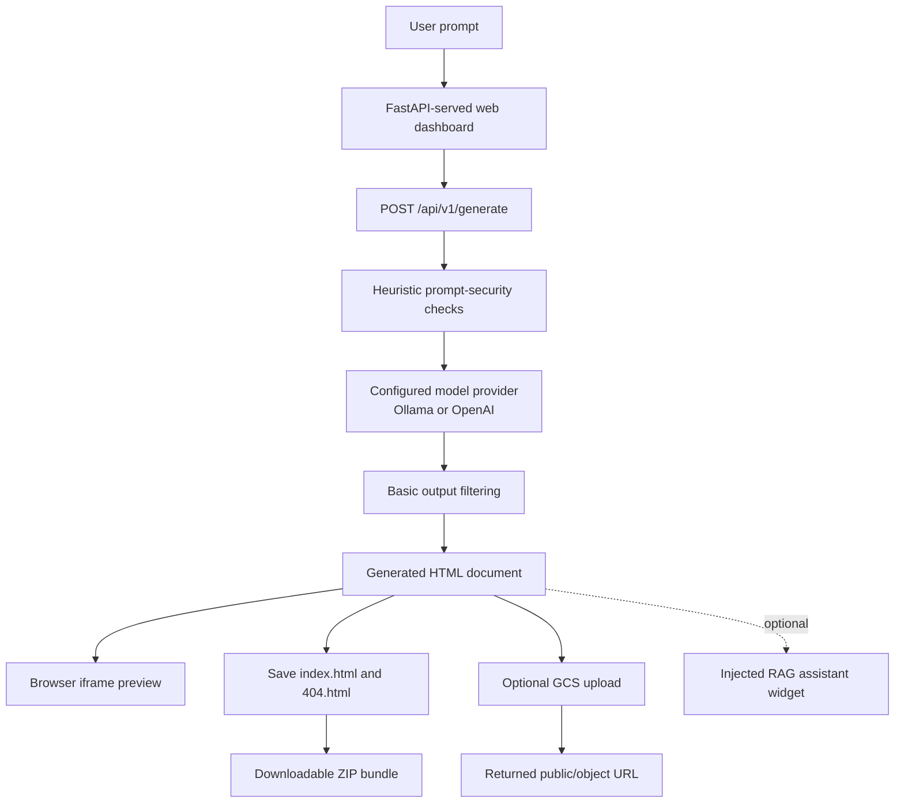

# AETHERIS-WEBFORGE

**AI-powered single-file web application generation, preview, optional RAG widget injection, and Google Cloud Storage deployment.**


AETHERIS-WEBFORGE is an AI-assisted web application generator. It accepts a natural-language description, asks a configurable model provider to generate a complete HTML document, displays the result in a browser preview, and can package the site or publish it to a Google Cloud Storage bucket.

The project is designed to support a local inference workflow through Ollama, with an OpenAI API option in the generation backend. It also includes heuristic prompt-injection checks, basic output filtering, document-extraction utilities, a lightweight context-grounding check, and code for injecting an optional RAG assistant into generated pages.

> **Project status:** This is a demonstration/MVP, not a security-certified or production-hardened platform. Review the [Security and limitations](#security-and-limitations) section before exposing it to a network or deploying generated content publicly.

## Contents

- [Capabilities](#capabilities)
- [Architecture](#architecture)
- [Technology stack](#technology-stack)
- [Demonstration](#demonstration)
- [Repository structure](#repository-structure)
- [Requirements](#requirements)
- [Run locally](#run-locally)
- [Run with Docker](#run-with-docker)
- [Using the application](#using-the-application)
- [Google Cloud Storage deployment](#google-cloud-storage-deployment)
- [API reference](#api-reference)
- [Tests](#tests)
- [Security and limitations](#security-and-limitations)
- [Author](#author)
- [License](#license)

## Capabilities

- **Natural-language generation:** Generate a standalone HTML5 page from a written application brief.
- **Configurable model provider:** Use an OpenAI-compatible Ollama endpoint for local inference or the OpenAI API through the backend request interface.
- **Live preview:** Render the generated HTML in an iframe in the web dashboard.
- **Downloadable site bundle:** Save generated output as `index.html` and a companion `404.html`, packaged in `generated_site.zip`.
- **Google Cloud Storage publishing:** Upload generated HTML and a 404 page to a configurable bucket and return a URL.
- **Prompt screening:** Apply regex-based and heuristic checks for common prompt-injection patterns before generation.
- **Basic output filtering:** Remove a few known secret/system-prompt patterns from model output.
- **Optional RAG assistant injection:** Add a floating document-Q&A interface to generated HTML when RAG injection is enabled and context chunks are supplied.
- **Document utilities:** Extract text from PDF, DOCX, TXT, Markdown, and HTML files and split text into overlapping chunks.
- **Health endpoint:** Check whether the API process is responding.

The prompt guard and output filter are defense-in-depth utilities, not a guarantee that generated HTML is safe. See [Security and limitations](#security-and-limitations).

## Architecture



### Main components

| Component | Responsibility |
|---|---|
| `app.py` | FastAPI routes and browser dashboard; generation, deployment, health, and ZIP-download endpoints |
| `config.py` | Environment-based defaults for model provider, Ollama, OpenAI, output paths, and application settings |
| `core/generator.py` | Builds the generation prompt, invokes the selected provider, strips code fences and filters selected leak patterns |
| `core/security.py` | Prompt-pattern checks, basic output filtering, and word-overlap context-grounding helper |
| `core/extractor.py` | Extracts text from PDF, DOCX, TXT, Markdown, and HTML files and creates overlapping chunks |
| `core/rag_injector.py` | Adds a branded header and, when enabled, a floating RAG assistant interface to HTML |
| `core/deployer.py` | Saves generated pages, creates a ZIP bundle, and uploads site files to Google Cloud Storage |
| `Dockerfile` | Builds the Python 3.10 container image |
| `deploy_gcp.sh` | Provisions/configures Google Cloud resources and deploys the container through Cloud Build and Cloud Run |
| `test_system.py` | Small integration-style checks for prompt screening, grounding, widget injection, and bundle creation |

## Technology stack

| Layer | Technologies |
|---|---|
| Language | Python 3.10 |
| API and serving | FastAPI, Uvicorn, Pydantic |
| Model client | OpenAI Python SDK (including OpenAI-compatible endpoints) |
| Local inference option | Ollama |
| Front end | HTML, CSS, JavaScript served by FastAPI |
| Document processing | pypdf, python-docx |
| Cloud storage | Google Cloud Storage Python client |
| Packaging and runtime | Docker |
| Cloud deployment script | Google Cloud CLI, Cloud Build, Cloud Run, Cloud Storage |

## Demonstration

The screenshots below are stored in this project folder. The paths are relative to this `README.md`; keep the exact filenames in place for GitHub to render them.

### 1. Prompt and generation interface

Enter a natural-language description for the website you want to create. The dashboard includes the generation action, deployment control, and preview area.


### 2. Generated PDF toolkit website

A demonstration of a generated PDF-toolkit-style interface. The screenshot illustrates the generated page; it does not imply that every PDF operation has been independently audited for correctness or security.


### 3. Google Cloud deployment result

The deployment demonstration shows a generated site published to Google Cloud Storage and the resulting URL.


## Repository structure

```text
01-aetheris-webforge/
├── README.md
├── app.py                 # FastAPI API and browser dashboard
├── config.py              # Environment-backed defaults
├── requirements.txt       # Python dependencies
├── Dockerfile             # Container build
├── deploy_gcp.sh          # Google Cloud provisioning/deployment script
├── test_system.py         # Small integration-style test runner
├── core/
│   ├── __init__.py
│   ├── generator.py        # Model-backed HTML generation
│   ├── security.py         # Prompt checks and grounding helper
│   ├── extractor.py        # Document text extraction and chunking
│   ├── rag_injector.py     # Optional assistant-widget injection
│   └── deployer.py         # ZIP creation and GCS upload
├── lov1.png               # Generation interface
├── lov2.png               # Generated PDF toolkit example
└── lov3gcpdeployed.png    # GCS deployment demonstration
```

## Requirements

- Python 3.10, or Docker.
- An available model endpoint:
  - **Ollama** running locally or on a reachable host, with the model you configure pulled; or
  - An OpenAI API key supplied to a generation API request when using the OpenAI provider.
- For Google Cloud Storage publishing: Google Cloud credentials with suitable bucket permissions, or a service-account JSON key provided for a local demonstration.
- For `deploy_gcp.sh`: Google Cloud CLI access, an active project, and permission to enable APIs, create/configure storage resources, submit Cloud Build jobs, and deploy Cloud Run services.

The repository currently does **not** include an `.env.example` file. Create a local `.env` file yourself if you use Docker, and do not commit it.

## Run locally

### 1. Clone the parent repository

This project is a folder inside `production-ai-engineering`.

```bash
git clone https://github.com/shubham-61291/production-ai-engineering.git
cd production-ai-engineering/01-aetheris-webforge
```

### 2. Create a virtual environment and install dependencies

**Windows PowerShell:**

```powershell
py -3.10 -m venv .venv
.\.venv\Scripts\Activate.ps1
python -m pip install --upgrade pip
python -m pip install -r requirements.txt
```

**Linux/macOS:**

```bash
python3.10 -m venv .venv
source .venv/bin/activate
python -m pip install --upgrade pip
python -m pip install -r requirements.txt
```

### 3. Configure Ollama

Install and start Ollama separately, then pull the model you intend to use. For example:

```bash
ollama pull qwen2.5-coder:32b
```

The current configuration defaults to `deepseek-r1:32b`; override it if you use the Qwen model shown in the example:

**PowerShell:**

```powershell
$env:LLM_PROVIDER = "ollama"
$env:OLLAMA_BASE_URL = "http://localhost:11434/v1"
$env:OLLAMA_MODEL = "qwen2.5-coder:32b"
python app.py
```

**Linux/macOS:**

```bash
export LLM_PROVIDER=ollama
export OLLAMA_BASE_URL=http://localhost:11434/v1
export OLLAMA_MODEL=qwen2.5-coder:32b
python app.py
```

Use the exact model identifier available in your Ollama installation. The model size and generation speed depend on available hardware.

### 4. Open the dashboard

Visit:

```text
http://localhost:7860
```

API documentation is available at `http://localhost:7860/docs`, and the health endpoint is `http://localhost:7860/api/v1/health`.

## Run with Docker

Start Ollama on the host first, pull the model, then create a `.env` file in `01-aetheris-webforge`:

```env
LLM_PROVIDER=ollama
OLLAMA_BASE_URL=http://host.docker.internal:11434/v1
OLLAMA_MODEL=qwen2.5-coder:32b
GCP_BUCKET_NAME=aetheris-generated-sites
```

`host.docker.internal` is commonly available with Docker Desktop. On Linux or custom Docker networks, configure a reachable Ollama address for your environment.

Build and run:

```bash
docker build -t aetheris-webforge .
docker run -d \
  --name aetheris-webforge \
  -p 7860:7860 \
  --env-file .env \
  --restart unless-stopped \
  aetheris-webforge
```

Open `http://localhost:7860`. To view logs or stop the container:

```bash
docker logs -f aetheris-webforge
docker stop aetheris-webforge
```

If a container with the same name already exists, remove or rename it before running the command again.

## Using the application

1. Open the dashboard and enter a detailed description of the web application.
2. Select or configure the model provider through the backend request/configuration appropriate to your setup.
3. Choose **Generate Website**.
4. Review the returned page in the preview panel and check that the generated interactions behave as expected.
5. Use the GCP deployment control only after reviewing the generated HTML and confirming the target bucket and its access policy.
6. Use the download endpoint to retrieve the generated site ZIP when a bundle has been created.

Example prompt:

> Create a responsive PDF toolkit landing page with merge, split, compress, and convert sections, clear user instructions, and an accessible mobile-friendly layout.

Generated HTML may reference external CDNs or image URLs depending on the prompt and model output. A single HTML file does not mean the generated site is guaranteed to work offline.

## Google Cloud Storage deployment

The application uses Application Default Credentials through `google-cloud-storage` when no service-account JSON key is supplied. A JSON key can also be provided to the deployment API for a local demonstration; avoid this method where possible and never commit the key.

The deployment helper:

1. Connects to the configured bucket, creating it if it does not exist.
2. Configures website main-page and error-page settings.
3. Uploads `index.html` and `404.html`.
4. Returns the resulting Google Cloud Storage URLs.

The default bucket name is `aetheris-generated-sites`; the API request and environment can override it. The bucket and its access permissions must be configured for the way you intend to serve the site.

### Optional deployment script

`deploy_gcp.sh` is a broader infrastructure script that enables APIs, creates/configures a bucket, grants public object viewing, submits an image build, and deploys Cloud Run with unauthenticated access. Review every command and permission before running it; those public-access settings are not appropriate for every project.

## API reference

The API is served by FastAPI. When running locally, interactive schema documentation is available at `http://localhost:7860/docs`.

| Method | Endpoint | Purpose |
|---|---|---|
| `GET` | `/api/v1/health` | Return service status |
| `POST` | `/api/v1/generate` | Generate HTML from a prompt; supports provider/model configuration in the request body |
| `POST` | `/api/v1/rag/query` | Prototype context-grounding check for a supplied question and context chunks |
| `POST` | `/api/v1/deploy` | Upload supplied HTML to Google Cloud Storage |
| `GET` | `/api/v1/download-zip` | Download the generated ZIP bundle, if present |

Example generation request using the local Ollama endpoint:

```bash
curl -X POST http://localhost:7860/api/v1/generate \
  -H "Content-Type: application/json" \
  -d '{"prompt":"Create a responsive personal portfolio page","provider":"ollama","ollama_url":"http://localhost:11434/v1","ollama_model":"qwen2.5-coder:32b"}'
```

The `/api/v1/rag/query` route is currently a prototype: its handler verifies a fixed sample answer against the supplied context rather than performing a full request-time model call. The document extraction helpers and injected assistant UI are also not wired to a complete document-upload pipeline in the basic dashboard flow. Treat the RAG route as demonstration code until that integration is implemented and validated.

## Tests

Install the project dependencies, activate the virtual environment, and run the included test runner from this folder:

```bash
python test_system.py
```

The script checks representative cases for prompt-injection pattern detection, context-overlap grounding, optional RAG widget injection, and site ZIP creation. These are small integration-style checks, not comprehensive security, browser, model-quality, or cloud-deployment tests.

## Security and limitations

- **Prompt filtering is heuristic.** Regex patterns catch some common injection phrases but do not prevent all prompt injection or unsafe model output.
- **Generated HTML is untrusted code.** Review it before publishing or embedding it in a trusted origin. Generated output may contain JavaScript, external resources, or unexpected behavior.
- **The API has no built-in authentication.** Do not expose it directly to the public internet without adding authentication, authorization, rate limits, request-size limits, and operational monitoring.
- **CORS is permissive in the current application.** Restrict allowed origins and configure credentials correctly before deploying beyond a trusted local environment.
- **Protect cloud credentials.** Prefer scoped Application Default Credentials or workload identity. Never commit service-account JSON keys, API keys, or local `.env` files.
- **Public storage is a deliberate configuration choice.** The optional deployment script grants `allUsers` object-viewer access. Anyone with access to a public URL may be able to view the hosted page.
- **Provider data handling differs.** With local Ollama, inference can stay within the configured local environment. With OpenAI, prompts are sent to the OpenAI API under that provider's terms and policies.
- **RAG is experimental.** The current API route does not yet run a full retrieval-and-generation request, and the standard generation endpoint passes an empty context-chunk list to the injector.
- **Generated-page quality is not guaranteed.** Review accessibility, browser compatibility, dependencies, business logic, and security manually before real-world use.
- **Deployment and preview are different concerns.** A previewed HTML page is not proof that cloud permissions, public routing, or all generated features work correctly after deployment.

## Author

**Shubham Kumar Singh**

## License

This project is licensed under the MIT License.

Copyright (c) 2026 Shubham Kumar Singh

Permission is hereby granted, free of charge, to any person obtaining a copy
of this software and associated documentation files (the "Software"), to deal
in the Software without restriction, including without limitation the rights
to use, copy, modify, merge, publish, distribute, sublicense, and/or sell
copies of the Software, and to permit persons to whom the Software is
furnished to do so, subject to the following conditions:

The above copyright notice and this permission notice shall be included in all
copies or substantial portions of the Software.

THE SOFTWARE IS PROVIDED "AS IS", WITHOUT WARRANTY OF ANY KIND, EXPRESS OR
IMPLIED, INCLUDING BUT NOT LIMITED TO THE WARRANTIES OF MERCHANTABILITY,
FITNESS FOR A PARTICULAR PURPOSE AND NONINFRINGEMENT. IN NO EVENT SHALL THE
AUTHORS OR COPYRIGHT HOLDERS BE LIABLE FOR ANY CLAIM, DAMAGES OR OTHER
LIABILITY, WHETHER IN AN ACTION OF CONTRACT, TORT OR OTHERWISE, ARISING FROM,
OUT OF OR IN CONNECTION WITH THE SOFTWARE OR THE USE OR OTHER DEALINGS IN THE
SOFTWARE.
