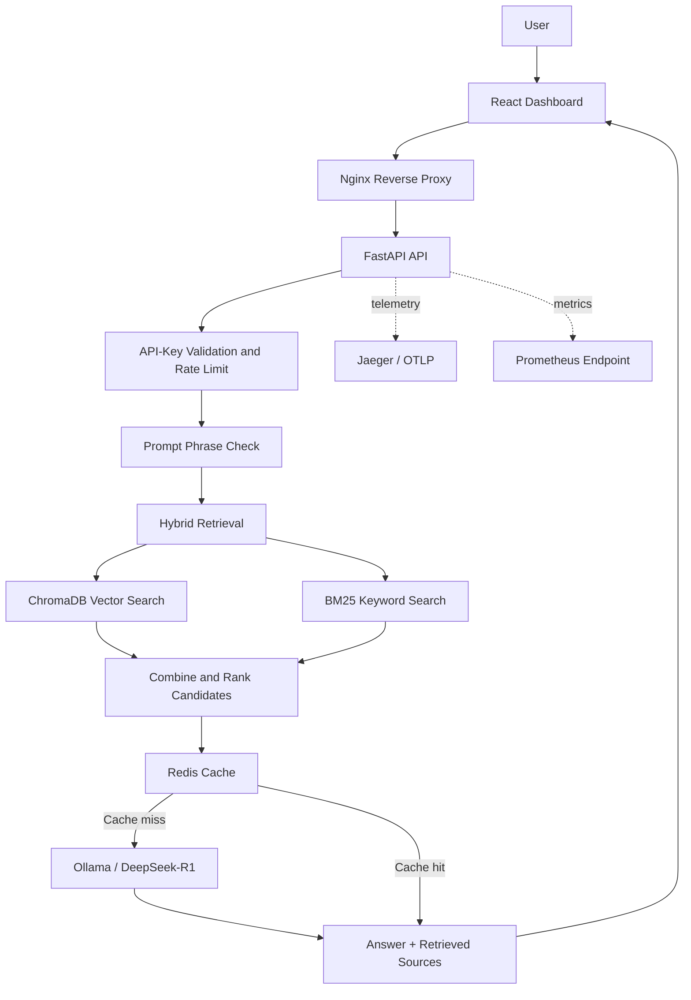

# Magnetar AI

**Self-hosted hybrid Retrieval-Augmented Generation (RAG) with local LLM inference, document ingestion, API-key protection, query caching, and operational observability.**

[](https://www.python.org/)
[](https://fastapi.tiangolo.com/)
[](https://react.dev/)
[](https://docs.docker.com/compose/)
[](#license)

Magnetar AI is a self-hostable document-question-answering service. It ingests PDF, DOCX, and text documents, retrieves relevant passages using dense vector search and BM25 keyword search, and supplies that context to a locally hosted Ollama model. A React dashboard provides document upload and query workflows, while the API includes API-key authentication, request rate limits, Redis caching, health checks, and telemetry integrations.

> **Project status and boundary:** This repository is an engineering implementation and demonstration, not a guarantee of production security or factual correctness. Answers can be incomplete or incorrect; review source passages before relying on results for legal, compliance, or other high-impact decisions.

---

## Contents

- [Overview](#overview)
- [Features](#features)
- [Architecture](#architecture)
- [Technology Stack](#technology-stack)
- [Screenshots](#screenshots)
- [Repository Structure](#repository-structure)
- [Quick Start: Local Development](#quick-start-local-development)
- [Use the Dashboard](#use-the-dashboard)
- [HTTP API](#http-api)
- [Docker Compose and GCP Deployment](#docker-compose-and-gcp-deployment)
- [Tests](#tests)
- [Security Considerations](#security-considerations)
- [Known Limitations](#known-limitations)
- [Author](#author)
- [License](#license)

## Overview

Magnetar AI is designed for searchable internal knowledge bases and document-grounded question answering. Its pipeline is:

**Upload → Extract text → Chunk → Index → Retrieve → Generate an answer with source passages**

The implementation maintains a persistent ChromaDB collection and a separate BM25 index. Retrieved passages are combined and ranked before being passed to Ollama. Redis can cache repeated question-and-context combinations to avoid repeating inference for an identical request.

## Features

- **Hybrid retrieval:** ChromaDB dense-vector retrieval and BM25 keyword retrieval are combined to broaden evidence matching.
- **Local model inference:** The backend calls an Ollama-compatible `/api/generate` endpoint; the configured default model is `deepseek-r1:32b`.
- **Document ingestion:** Upload PDF, DOCX, or text content and split it into overlapping word-based chunks for indexing.
- **Source-aware responses:** Query responses include the retrieved source chunks and their metadata alongside the generated answer.
- **Input screening:** The `/ask` route checks for a small set of suspicious prompt-injection phrases before retrieval and generation.
- **API-key authentication:** Protected routes validate the `X-API-Key` header.
- **Rate limiting and caching:** SlowAPI limits requests, while Redis caches eligible answer results.
- **Operational endpoints:** Health information is available from `/health`; Prometheus metrics are mounted at `/metrics` and require API-key authentication.
- **Tracing and logging hooks:** FastAPI and HTTPX OpenTelemetry instrumentation is configured, with OTLP export settings supplied by the Compose deployment.
- **Containerized deployment:** The Compose configuration includes the API, Redis, Jaeger, Nginx, and Certbot services.

## Architecture



### Components

| Component | Responsibility |
|---|---|
| React + Vite frontend | Document upload, query input, API-key entry, response and source display |
| FastAPI | Authenticated upload, query, delete, health, and metrics routes |
| ChromaDB | Persistent vector collection for document chunks |
| BM25 (`rank-bm25`) | Keyword retrieval over the stored chunk text |
| Ollama | Local language-model inference; default model is `deepseek-r1:32b` |
| Redis | Cached answer storage with configurable TTL |
| Nginx | Serves the built frontend, reverse-proxies `/api/`, and terminates HTTPS in the Compose setup |
| Jaeger / OpenTelemetry | Trace collection and instrumentation integration |
| Prometheus client | Metrics endpoint exposed by the API |

## Technology Stack

| Layer | Technologies |
|---|---|
| Language | Python 3.10, JavaScript |
| Backend | FastAPI, Uvicorn, Pydantic, HTTPX |
| Frontend | React 18, Vite, CSS |
| Retrieval | ChromaDB, `rank-bm25` |
| Model serving | Ollama API, default `deepseek-r1:32b` |
| Model/document utilities | Sentence Transformers, Transformers, spaCy, PyPDF, python-docx |
| Security and reliability | API-key validation, phrase-based prompt screening, SlowAPI rate limiting |
| Cache | Redis 7 |
| Observability | OpenTelemetry, Jaeger, Prometheus client, structured logging |
| Deployment | Docker, Docker Compose, Nginx, Certbot, Google Cloud tooling |

## Screenshots

The following screenshots show the dashboard and example query behavior. The policy document used for the demonstration is fictional and AI-generated; it is not an official Sony India policy document.

### 1. Main Interface


### 2. Query: Working Hours


### 3. Query: Monetary Gifts Policy


### 4. Prompt-Injection Phrase Blocked


### Test-document disclaimer

The Sony India Policy document shown in the screenshots was generated for demonstration purposes. It does not represent the real policies of Sony India or its affiliates, contains no confidential or proprietary policy material, and must not be cited as an official source.

## Repository Structure

```text
02-magnetar-ai/
├── app/
│   ├── main.py                 # FastAPI application, health and metrics
│   ├── routers/
│   │   ├── ask.py              # Query, retrieval, caching, Ollama response
│   │   ├── upload.py           # File upload, extraction and indexing
│   │   └── delete.py           # Remove document chunks from indexes
│   └── core/
│       ├── auth.py             # X-API-Key validation
│       ├── cache.py            # Redis cache
│       ├── config.py           # Environment-backed settings
│       ├── limiter.py          # Request rate limiting
│       ├── rag.py              # ChromaDB + BM25 retrieval store
│       ├── tracing.py          # OpenTelemetry setup
│       └── utils.py            # Shared HTTP and logging helpers
├── frontend/
│   ├── src/                    # React application
│   ├── index.html
│   ├── package.json
│   └── vite.config.js
├── scripts/
│   └── download_models.py      # Download helper for listed model assets
├── tests/                      # API, auth, upload, delete and health tests
├── hybridrag1.png
├── hybridrag2.png
├── hybridrag3.png
├── hybridrag4.png
├── Dockerfile
├── docker-compose.yml
├── nginx.conf.template
├── nginx-startup.sh
├── certbot-renew.sh
├── setup_vm.sh
├── requirements.txt
└── .env.example
```

## Quick Start: Local Development

The following steps describe a local development setup. The production-oriented Compose file is covered separately below because its API service references an image in Google Artifact Registry.

### Prerequisites

- Python 3.10
- Node.js 20 or compatible current Node.js release
- Docker, for Redis
- [Ollama](https://ollama.com/) with enough memory/GPU capacity for your selected model

### 1. Enter the project directory

Clone the parent repository and enter the Magnetar AI subdirectory:

```bash
git clone https://github.com/shubham-61291/production-ai-engineering.git
cd production-ai-engineering/02-magnetar-ai
```

### 2. Configure environment variables

Create a local `.env` file from the supplied template:

```bash
cp .env.example .env
```

Edit `.env` and set at least:

```env
API_KEY=replace-with-a-long-random-secret
REDIS_URL=redis://localhost:6379
REDIS_PASSWORD=replace-with-a-strong-redis-password
OLLAMA_URL=http://localhost:11434
OLLAMA_MODEL=deepseek-r1:32b
CHROMA_PERSIST_DIR=./chroma_data
BM25_DATA_DIR=./bm25_data
MAX_UPLOAD_SIZE_MB=10
CORS_ORIGINS=["http://localhost:3000", "http://127.0.0.1:3000"]
```

Use unique secrets. Never commit `.env` or real credentials.

### 3. Install Python dependencies

From `02-magnetar-ai/`:

```bash
python -m venv .venv
```

Activate the environment, then install dependencies:

```bash
# Linux/macOS
source .venv/bin/activate

# Windows PowerShell
# .\.venv\Scripts\Activate.ps1

python -m pip install --upgrade pip
pip install -r requirements.txt
```

### 4. Start Redis and Ollama

Start Redis with the same password configured in `.env`:

```bash
docker run -d --name magnetar-redis -p 6379:6379 \
  redis:7-alpine redis-server --requirepass "replace-with-a-strong-redis-password"
```

If the container already exists, start it with `docker start magnetar-redis`.

Ensure Ollama is installed and running, then download the configured model:

```bash
ollama pull deepseek-r1:32b
```

The model is large; check available system memory and GPU resources before downloading. You can set `OLLAMA_MODEL` to another model supported by your installation.

The repository also includes an optional helper for downloading the DeBERTa prompt-injection model, Sentence Transformers model, and spaCy language model:

```bash
python scripts/download_models.py
```

The current `/ask` request handler uses phrase-based checks; it does not load the DeBERTa model in that request path.

### 5. Run the API

```bash
uvicorn app.main:app --host 127.0.0.1 --port 8000 --reload
```

Check the health endpoint:

```bash
curl http://127.0.0.1:8000/health
```

Interactive API documentation is available at `http://127.0.0.1:8000/docs`.

### 6. Run the frontend

Open a second terminal:

```bash
cd production-ai-engineering/02-magnetar-ai/frontend
npm install
npm run dev
```

Vite serves the UI at `http://localhost:3000` and proxies `/api` requests to `http://localhost:8000`.

## Use the Dashboard

1. Open the frontend in your browser.
2. Enter the API key matching `API_KEY` in `.env`.
3. Upload a PDF, DOCX, or text document within the configured size limit.
4. Wait for the API to extract the text, split it into chunks, and index it.
5. Ask a question about the uploaded material.
6. Review the answer and retrieved source passages. Verify important claims against the original document.
7. Remove a document using the UI if that control is available, or use the delete endpoint with its returned document ID.

### Example questions

Using the fictional policy document from the screenshots:

- “What is the dress code policy at Sony India Bangalore?”
- “What is the policy on offering monetary gifts to government officials?”

These examples refer only to the synthetic test document, not to an actual corporate policy.

## HTTP API

All protected endpoints require the header `X-API-Key: <your API key>`.

| Method | Endpoint | Purpose | Authentication |
|---|---|---|---|
| `GET` | `/health` | Check API and dependency health | No API key in current implementation |
| `POST` | `/api/v1/upload` | Upload and index a document | Required |
| `POST` | `/api/v1/ask` | Retrieve context and generate an answer | Required |
| `DELETE` | `/api/v1/delete/{doc_id}` | Remove a document from the indexes | Required |
| `GET` | `/metrics` | Prometheus metrics | Required via `X-API-Key` |
| `GET` | `/docs` | FastAPI interactive API docs | Depends on deployment/network controls |

### Ask a question

```bash
curl -X POST "http://127.0.0.1:8000/api/v1/ask" \
  -H "Content-Type: application/json" \
  -H "X-API-Key: replace-with-a-long-random-secret" \
  -d '{
    "question": "What does the document say about working hours?",
    "top_k": 5,
    "temperature": 0.0,
    "seed": 42,
    "max_tokens": 512
  }'
```

The response includes the question, answer, retrieved source objects, cache status, prompt-screening flag, and latency.

### Upload a document

```bash
curl -X POST "http://127.0.0.1:8000/api/v1/upload" \
  -H "X-API-Key: replace-with-a-long-random-secret" \
  -F "file=@./policy.pdf"
```

The response includes a `doc_id` and the number of chunks created. Use the returned ID for deletion:

```bash
curl -X DELETE "http://127.0.0.1:8000/api/v1/delete/<doc_id>" \
  -H "X-API-Key: replace-with-a-long-random-secret"
```

## Docker Compose and GCP Deployment

The repository includes a Dockerfile, Compose stack, Nginx configuration, and VM setup scripts. The Compose `api` service currently references a prebuilt image in Google Artifact Registry:

```text
${REGION}-docker.pkg.dev/${GCP_PROJECT_ID}/magnetar-images/magnetar-api:latest
```

It does **not** build that API image from the local Dockerfile by default. Before using Compose, build and push the API image to the configured registry, or modify the Compose service to use a local `build:` configuration.

### Build and push the API image

From `02-magnetar-ai/`, after authenticating with Google Cloud and configuring Docker for the relevant Artifact Registry region:

```bash
IMAGE="asia-south1-docker.pkg.dev/YOUR_GCP_PROJECT_ID/magnetar-images/magnetar-api:latest"
docker build -t "$IMAGE" .
docker push "$IMAGE"
```

Create and configure the `.env` values required by `docker-compose.yml`, including `REGION`, `GCP_PROJECT_ID`, `API_KEY`, `REDIS_PASSWORD`, `OLLAMA_URL`, `DOMAIN`, `CERTBOT_EMAIL`, and the configured storage/model paths. Build the React assets before starting Nginx:

```bash
cd frontend
npm install
npm run build
cd ..
```

Then start the configured stack:

```bash
docker compose up -d
```

The Compose stack publishes Nginx on ports `80` and `443`. Configure DNS for `DOMAIN`, allow the required inbound ports, and ensure the certificate-renewal configuration is valid before exposing the service.

### Ollama and GPU networking

Ollama runs natively on the host in the intended deployment model. The container must be able to reach `OLLAMA_URL`; the example environment uses the Docker bridge gateway address. Restrict access to Ollama at the host firewall and do not expose port `11434` publicly.

The supplied `setup_vm.sh` changes Ollama's listen address to `0.0.0.0` as part of its setup. Review that behavior and apply network restrictions before running the script on a reachable VM.

## Tests

Install the Python dependencies, configure `.env`, and run the test suite from the project directory:

```bash
python -m pytest -q
```

The tests cover API querying, API-key behavior, document upload and deletion, and health checks. They are not a substitute for end-to-end verification against the target Ollama model, GPU environment, TLS configuration, or GCP deployment.

## Security Considerations

- **Set a strong API key.** The example key in settings is a placeholder and must not be used for a public deployment.
- **Restrict CORS.** Set `CORS_ORIGINS` to the exact trusted dashboard origins rather than using a wildcard.
- **Protect Redis.** Use a strong password and keep Redis off public interfaces.
- **Keep secrets out of Git.** Do not commit `.env`, service-account JSON keys, API keys, or production data.
- **Limit network exposure.** Keep internal services private; expose only the reverse proxy as required.
- **Review generated answers.** Retrieval and prompt instructions do not guarantee that a model answer is correct or completely grounded.
- **Treat uploaded files as sensitive.** Apply access, retention, backup, and deletion policies appropriate to your data.

## Known Limitations

- **Prompt-injection detection is rule-based in the active query route.** `ask.py` checks a short list of literal phrases. The model-download script includes a DeBERTa model, but the current `/ask` handler does not run that classifier. This guard is not comprehensive protection against prompt injection.
- **No cross-encoder reranking.** The current retrieval implementation combines vector and BM25 scores; it does not implement reciprocal-rank fusion or a cross-encoder reranker.
- **Model failure can yield a placeholder response.** If Ollama responds unsuccessfully or cannot be reached, the current query handler returns a fallback/simulated response. Check the `answer` and `sources` fields and verify the model service is healthy before trusting results.
- **Document extraction is text-oriented.** Complex tables, scanned PDFs, layouts, and images may not be extracted accurately. OCR is not implemented in the shown upload route.
- **Chunking is word-based.** The upload route uses fixed-size chunks with overlap; chunk size can affect recall and relevance.
- **Local and Compose configurations differ.** Compose expects a prebuilt Artifact Registry image and production-oriented infrastructure values.
- **Production readiness requires separate validation.** Perform threat modeling, authorization tests, dependency audits, load tests, and deployment-specific security reviews before handling sensitive enterprise data.

## Author

**Shubham Kumar Singh**

## License

This project is licensed under the MIT License.

```text
MIT License

Copyright (c) 2026 Shubham Kumar Singh

Permission is hereby granted, free of charge, to any person obtaining a copy
of this software and associated documentation files (the "Software"), to deal
in the Software without restriction, including without limitation the rights
to use, copy, modify, merge, publish, distribute, sublicense, and/or sell
copies of the Software, and to permit persons to whom the Software is
furnished to do so, subject to the following conditions:

The above copyright notice and this permission notice shall be included in all
copies or substantial portions of the Software.

THE SOFTWARE IS PROVIDED "AS IS", WITHOUT WARRANTY OF ANY KIND, EXPRESS OR
IMPLIED, INCLUDING BUT NOT LIMITED TO THE WARRANTIES OF MERCHANTABILITY,
FITNESS FOR A PARTICULAR PURPOSE AND NONINFRINGEMENT. IN NO EVENT SHALL THE
AUTHORS OR COPYRIGHT HOLDERS BE LIABLE FOR ANY CLAIM, DAMAGES OR OTHER
LIABILITY, WHETHER IN AN ACTION OF CONTRACT, TORT OR OTHERWISE, ARISING FROM,
OUT OF OR IN CONNECTION WITH THE SOFTWARE OR THE USE OR OTHER DEALINGS IN THE
SOFTWARE.
```
