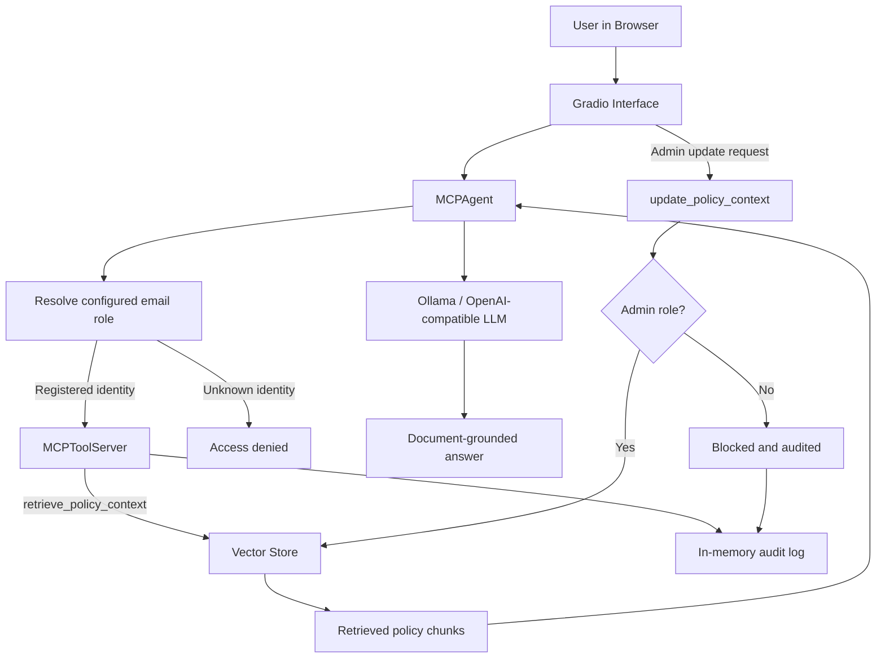
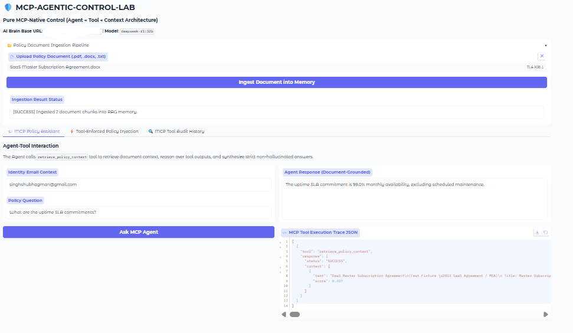
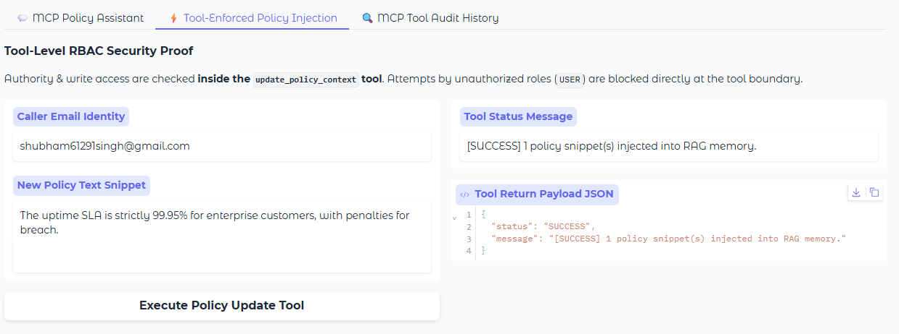
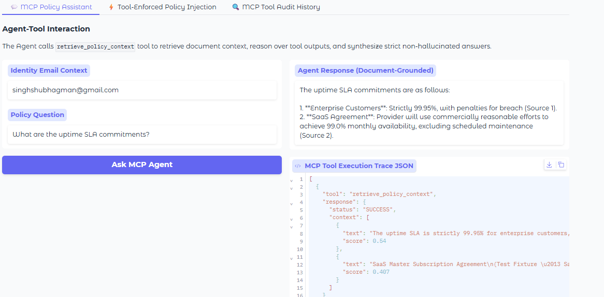
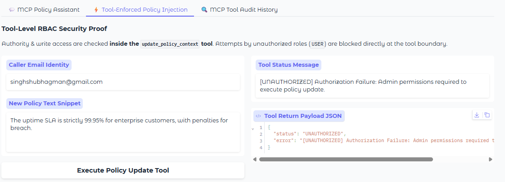
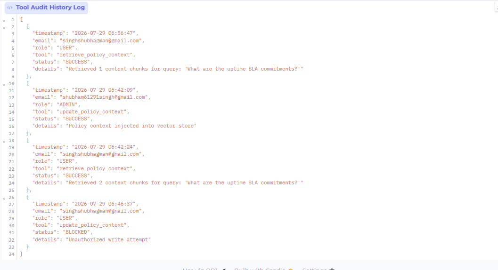

# MCP Agentic Control Lab

**A document-grounded policy assistant for exploring agent-to-tool control, role-based authorization, and auditable RAG workflows.**

[](https://www.python.org/)
[](https://www.gradio.app/)
[](#architecture)
[](#license)

---

## Overview

MCP Agentic Control Lab is a hands-on systems engineering project that explores a central question in agentic AI design:

> **Where should authority and access control be enforced: in the interface, or at the tool boundary?**

The application combines document ingestion, semantic retrieval, an LLM-based policy assistant, role checks, controlled policy updates, and a visible tool audit trail. It is intended for experimenting with control boundaries in document-grounded AI workflows—not as a drop-in, production identity provider.

The checked-in runnable application focuses on the **agent → tool → context** control pattern. Although the project framing discusses UI-orchestrated control as a comparison point, this folder does not currently contain a distinct, separately runnable MCP-Style implementation. The `app.py` and `mcp_native.py` entry points both exercise the tool-enforced flow.

## Key capabilities

- **Policy document ingestion:** Upload PDF, DOCX, or TXT files for text extraction, chunking, embedding, and indexing.
- **Document-grounded Q&A:** Retrieve relevant chunks and provide them to the configured language model as the answer context.
- **Role-aware access:** Resolve configured email identities into `ADMIN`, `USER`, or `UNKNOWN` roles.
- **Tool-level write authorization:** Check admin privileges inside `update_policy_context` before adding a policy snippet to the vector store.
- **Tool execution traces:** Display the retrieval tool response and context returned to the agent.
- **Audit history:** Record tool activity with timestamps, identity, role, operation, outcome, and details.
- **Pluggable vector storage:** Use persistent ChromaDB by default, Pinecone when configured, or an in-memory fallback.
- **Local or API-based inference:** Connect to an Ollama-compatible endpoint, with an optional OpenAI API fallback.
- **Containerized execution:** Run the Gradio application locally or through Docker Compose.

## How it works



### Main request flow

1. A user uploads a policy document; the parser extracts text and divides it into overlapping chunks.
2. The embedding model encodes each chunk, and the selected vector store indexes it.
3. A registered identity submits a policy question through the Gradio interface.
4. The agent invokes `retrieve_policy_context`, which searches the vector store and returns matching chunks.
5. The LLM receives the retrieved context and is instructed to answer from those sources only. When retrieval returns no matches, the agent returns a clarification/no-relevant-policy response instead of asking the model to invent an answer.
6. For policy changes, `update_policy_context` checks the caller's role inside the tool. Only the configured admin identity can write a policy snippet.
7. Tool outcomes are exposed in the UI and added to the in-process audit log.

## Important implementation boundary

The project demonstrates **MCP-inspired tool-boundary control**, but the current `MCPToolServer` is an in-process Python class. The dependency list does not include the official MCP SDK, and this repository does not currently expose a network-accessible, protocol-compatible MCP server for external MCP clients. The “MCP-Native” wording refers to the control-flow pattern being demonstrated, not a claim of official MCP protocol interoperability.

## Screenshots

The following screenshots are stored in the project directory and use repository-relative paths.

### 1. Policy assistant and normal user query

A registered user submits a question and the interface displays the answer together with the agent's tool trace.



### 2. Authorized admin policy update

The admin submits a policy snippet through the tool-enforced policy update interface.



### 3. Retrieval after policy update

A subsequent query demonstrates retrieval against the updated policy context.



### 4. Unauthorized policy update blocked

A non-admin identity attempts a write operation and the tool returns an authorization failure.



### 5. Tool audit history

The audit tab shows recorded tool activity and outcomes.



> **Demonstration data:** The screenshots use a fictional policy document for demonstration. Do not treat the sample policy as the actual policy of any named company or organization.

## Technology stack

| Layer | Technology | Role |
|---|---|---|
| Runtime | Python 3.10+ | Application and control logic |
| Interface | Gradio | Document ingestion, policy assistant, policy updates, audit view |
| Agent | Custom `MCPAgent` | Orchestrates retrieval and response synthesis |
| Tool boundary | Custom `MCPToolServer` | Retrieval, write authorization, tool audit records |
| LLM client | OpenAI-compatible client | Ollama-compatible inference and optional OpenAI fallback |
| Default model | `deepseek-r1:32b` | Local response generation when available |
| Embeddings | `sentence-transformers/all-MiniLM-L6-v2` | Semantic vector representations |
| Vector store | ChromaDB, Pinecone, or in-memory | Store and retrieve policy chunks |
| Parsing | PyPDF2, `python-docx`, `tiktoken` | PDF/DOCX/TXT extraction and token-aware chunking |
| Deployment | Docker, Docker Compose | Reproducible local/container execution |

## Project structure

```text
03-mcp-agentic-control-lab/
├── .env.example             # Environment-variable template
├── .gitignore
├── Dockerfile
├── docker-compose.yml
├── requirements.txt
├── README.md
├── app.py                   # Main Gradio interface
├── mcp_native.py            # Alternate MCP-native control-lab entry point
├── config.py                # LLM, vector-store, chunking, and role configuration
├── core/
│   ├── auth.py              # ADMIN / USER / UNKNOWN identity resolution
│   ├── document_parser.py   # PDF, DOCX, and TXT extraction and chunking
│   ├── embeddings.py        # SentenceTransformer embedding engine
│   ├── llm_brain.py         # Ollama/OpenAI-compatible LLM client
│   └── vector_store.py      # ChromaDB, Pinecone, and in-memory backends
├── mcp_core/
│   ├── agent.py             # Agent orchestration and policy update entry point
│   └── tools.py             # Retrieval/update operations and audit records
├── mcp1.png                 # Main interface and query
├── mcp2.png                 # Admin policy update
├── mcp3.png                 # Retrieval after update
├── mcp4.png                 # Unauthorized update blocked
└── mcp5.png                 # Tool audit history
```

## Quick start: local execution

### Prerequisites

- Python 3.10 or newer
- Git
- Ollama with a compatible model available locally, **or** an OpenAI API key for fallback inference
- Enough memory and compute for the chosen model. A 32B model typically requires substantial RAM/VRAM; adjust the model to fit your hardware.

### 1. Clone the repository

This project is a subdirectory of `production-ai-engineering`:

```bash
git clone https://github.com/shubham-61291/production-ai-engineering.git
cd production-ai-engineering/03-mcp-agentic-control-lab
```

### 2. Create and activate a virtual environment

```bash
python -m venv .venv
```

**Windows PowerShell:**

```powershell
.\.venv\Scripts\Activate.ps1
```

**Linux/macOS:**

```bash
source .venv/bin/activate
```

### 3. Install dependencies

```bash
python -m pip install --upgrade pip
pip install -r requirements.txt
```

### 4. Configure environment variables

```bash
cp .env.example .env
```

On Windows PowerShell, use:

```powershell
Copy-Item .env.example .env
```

Edit `.env` and set the values appropriate for your environment. The most relevant settings are:

```env
AI_BRAIN_BASE_URL=http://localhost:11434/v1
AI_BRAIN_MODEL=deepseek-r1:32b
AI_BRAIN_API_KEY=ollama
OPENAI_API_KEY=

VECTOR_STORE_PROVIDER=chroma
CHROMA_PERSIST_DIR=./chroma_db
EMBEDDING_MODEL_NAME=all-MiniLM-L6-v2
CHUNK_SIZE=256
CHUNK_OVERLAP=32

ADMIN_EMAIL=admin@example.com
USER_EMAIL=user@example.com
```

The example values above for admin/user email are illustrative. Use addresses you control for local testing. The embedding model is downloaded by SentenceTransformers when first initialized if it is not already cached.

### 5. Start the local model

If using Ollama, make sure Ollama is running and download the configured model:

```bash
ollama pull deepseek-r1:32b
```

Verify that the configured OpenAI-compatible base URL is reachable from the Python process. For a different model, update `AI_BRAIN_MODEL` in `.env`.

### 6. Launch the application

```bash
python app.py
```

Open [http://localhost:7860](http://localhost:7860).

The alternate entry point can be launched with `python mcp_native.py`; run only one entry point on port `7860` at a time.

## Quick start: Docker Compose

Docker Compose runs the Gradio application and mounts the ChromaDB persistence directory.

1. Create and edit `.env` as described above.
2. In `.env`, set `AI_BRAIN_BASE_URL=http://host.docker.internal:11434/v1` for container-to-host access. The `.env.example` value (`http://localhost:11434/v1`) is for local Python execution; inside a container, `localhost` refers to the container itself. On some Linux hosts, you may need to configure host-gateway access or set `AI_BRAIN_BASE_URL` to a reachable host address.
3. Build and start the application:

```bash
docker compose up -d --build
```

4. Open [http://localhost:7860](http://localhost:7860).

Useful commands:

```bash
docker compose logs -f
docker compose ps
docker compose down
```

The app container does not provision Ollama or download the 32B LLM for you. Run the model service separately on the host or point the application at a reachable inference endpoint.

## Configuration reference

| Variable | Default | Purpose |
|---|---|---|
| `AI_BRAIN_BASE_URL` | `http://localhost:11434/v1` | OpenAI-compatible model endpoint |
| `AI_BRAIN_MODEL` | `deepseek-r1:32b` | Model identifier sent to the inference endpoint |
| `AI_BRAIN_API_KEY` | `ollama` | Client key value for the configured compatible endpoint |
| `OPENAI_API_KEY` | Empty | Optional fallback key; keep it secret |
| `VECTOR_STORE_PROVIDER` | `chroma` | `chroma`, `pinecone`, or in-memory fallback |
| `CHROMA_PERSIST_DIR` | `./chroma_db` | Local persistent ChromaDB location |
| `PINECONE_API_KEY` | Empty | Required only for Pinecone |
| `PINECONE_REGION` | `us-east-1` | Pinecone serverless region used by the client |
| `PINECONE_INDEX_NAME` | `mcp-rag-index` | Pinecone index name |
| `EMBEDDING_MODEL_NAME` | `all-MiniLM-L6-v2` | SentenceTransformer embedding model |
| `CHUNK_SIZE` | `256` | Chunk size in tokens |
| `CHUNK_OVERLAP` | `32` | Token overlap between chunks |
| `ADMIN_EMAIL` | `xyz@gmail.com` in config | Email string mapped to the `ADMIN` role |
| `USER_EMAIL` | `abc@gmail.com` in config | Email string mapped to the `USER` role |

## Using the interface

### Ingest a policy document

1. Open the **Policy Document Ingestion Pipeline** section (or the ingestion tab in `mcp_native.py`).
2. Upload a PDF, DOCX, or TXT file.
3. Select the ingestion button and wait for the chunk count/status message.

### Ask a policy question

1. In the **MCP Policy Assistant** tab, enter the configured user email.
2. Enter a question about the uploaded document.
3. Select **Ask MCP Agent**.
4. Review the answer and the JSON tool execution trace.

### Test tool-level authorization

1. In **Tool-Enforced Policy Injection**, submit a policy snippet using the configured admin identity; the tool should accept valid text.
2. Repeat with the configured user identity; the tool should return an unauthorized outcome.
3. Refresh **MCP Tool Audit History** to inspect recorded tool outcomes.

### Example questions

Use questions tied to the policy document you uploaded, such as:

- “What is the dress code policy?”
- “What are the requirements for remote work?”
- “What are the policy limits for gifts to government officials?”

These are examples only. The application can answer only when relevant information exists in the indexed context.

## Security model and limitations

This repository is a demonstration and research lab. It is **not production-ready identity or policy infrastructure without additional controls**.

- **Email-based identity is not authentication.** The UI accepts an email string, and the code maps it to a role. There is no independent login, verified identity provider, session management, or signed identity token in this implementation. Anyone who can access the UI may be able to enter the configured admin email. Do not expose this demo publicly with real policies.
- **Tool-level authorization is demonstrated for policy writes.** The `update_policy_context` tool checks whether the resolved role is `ADMIN` before updating the vector store. The identity source itself must be secured in a real deployment.
- **Audit records are in memory.** The audit log records retrieval and policy-update outcomes handled by the tool server; it is not a durable, tamper-resistant audit store and will be lost when the process restarts.
- **No cross-encoder reranker.** Retrieval is based on vector similarity and a configured score threshold.
- **Similarity threshold is currently hard-coded at `0.45`** in `mcp_core/tools.py`; adjust it there if evaluation supports a different threshold.
- **Chunking involves trade-offs.** Defaults are 256 tokens with 32 tokens of overlap. Larger chunks may preserve more policy context but can add irrelevant text; tune against a representative evaluation set.
- **Model output can still be wrong.** Prompt instructions to use supplied context do not provide a formal guarantee against hallucinations. Validate outputs for high-stakes or regulated use cases.
- **Document extraction has limits.** Scanned PDFs, complex layouts, tables, and images may require OCR or a more capable document parser.
- **Pinecone requires separate credentials and network access.** The implementation may fall back to in-memory storage if Pinecone initialization fails; in-memory data does not survive process restarts.
- **External model calls affect data handling.** With OpenAI fallback enabled, prompts and retrieved context may be sent to the configured API provider. Review applicable data-handling requirements before use.
- **Do not commit secrets or sensitive policies.** Keep `.env`, API keys, credentials, and private policy documents out of version control.

## Troubleshooting

**The UI starts, but questions return an LLM error**

- Confirm Ollama is running and the configured model has been pulled.
- Check `AI_BRAIN_BASE_URL` and `AI_BRAIN_MODEL`.
- From Docker, ensure the configured host URL is accessible from the container.
- If using fallback inference, configure `OPENAI_API_KEY` locally and protect it as a secret.

**No context is retrieved**

- Verify ingestion returned a non-zero chunk count.
- Ask a question that uses terms or concepts present in the source document.
- Inspect `CHUNK_SIZE`, `CHUNK_OVERLAP`, and the `min_score` value in `mcp_core/tools.py`.
- Confirm the selected vector-store backend initialized successfully.

**The model is too large for local hardware**

Choose a smaller Ollama model and update `AI_BRAIN_MODEL`. The configured model identifier must match a model available to the inference endpoint.

**Docker cannot connect to Ollama**

Do not use the container's `localhost` to refer to the host. Set `AI_BRAIN_BASE_URL` to the correct host-reachable endpoint and check host firewall and Ollama bind settings.

## License

MIT License

Copyright (c) 2026 Shubham Kumar Singh

Permission is hereby granted, free of charge, to any person obtaining a copy of this software and associated documentation files (the "Software"), to deal in the Software without restriction, including without limitation the rights to use, copy, modify, merge, publish, distribute, sublicense, and/or sell copies of the Software, and to permit persons to whom the Software is furnished to do so, subject to the following conditions:

The above copyright notice and this permission notice shall be included in all copies or substantial portions of the Software.

THE SOFTWARE IS PROVIDED "AS IS", WITHOUT WARRANTY OF ANY KIND, EXPRESS OR IMPLIED, INCLUDING BUT NOT LIMITED TO THE WARRANTIES OF MERCHANTABILITY, FITNESS FOR A PARTICULAR PURPOSE AND NONINFRINGEMENT. IN NO EVENT SHALL THE AUTHORS OR COPYRIGHT HOLDERS BE LIABLE FOR ANY CLAIM, DAMAGES OR OTHER LIABILITY, WHETHER IN AN ACTION OF CONTRACT, TORT OR OTHERWISE, ARISING FROM, OUT OF OR IN CONNECTION WITH THE SOFTWARE OR THE USE OR OTHER DEALINGS IN THE SOFTWARE.

## Author

**Shubham Kumar Singh**
