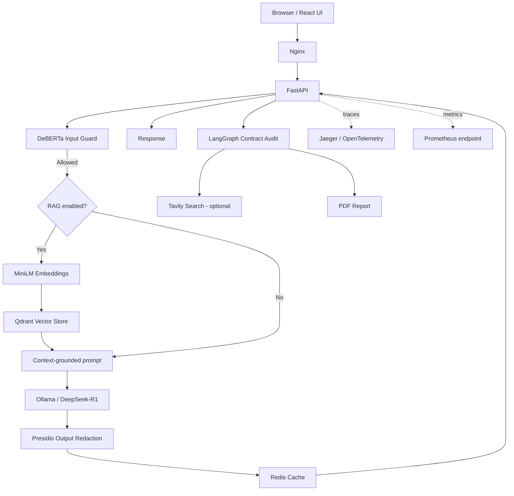

# Magnetar Webstack

**A self-hosted AI assistant combining local LLM inference, document-grounded retrieval, privacy-oriented output filtering, and multi-agent contract review.**


Magnetar Webstack brings conversational AI, document retrieval, and a LangGraph-based legal-audit workflow into one web application. It combines a React and TypeScript interface with a FastAPI backend, Ollama inference, Qdrant vector search, Redis caching and job state, and telemetry through OpenTelemetry, Jaeger, and Prometheus.

> **Repository state and deployment caveat:** The current repository tree does not contain `app/models/schemas.py`, yet the API routers and utility modules import `app.models.schemas`. This prevents the application from importing successfully in a clean checkout until that module is restored. The setup and API sections below document the checked-in implementation and its intended configuration; they should not be interpreted as evidence that a fresh end-to-end deployment has been verified.

## Table of contents

- [Overview](#overview)
- [Features](#features)
- [Architecture](#architecture)
- [Request flows](#request-flows)
- [Technology stack](#technology-stack)
- [Repository structure](#repository-structure)
- [Screenshots](#screenshots)
- [Run locally with Docker Compose](#run-locally-with-docker-compose)
- [Configuration](#configuration)
- [API reference](#api-reference)
- [Validation and tests](#validation-and-tests)
- [Security, privacy, and limitations](#security-privacy-and-limitations)
- [CI/CD](#cicd)
- [References](#references)
- [Author](#author)
- [License](#license)

## Overview

Magnetar Webstack supports three connected workflows:

1. **Chat:** Send a question to a locally hosted Ollama model with configurable temperature and output length.
2. **Document Q&A:** Upload PDF, DOCX, TXT, or Markdown documents; extract and chunk their text; embed the chunks; and retrieve session-scoped context for questions.
3. **Contract audit:** Run a four-stage LangGraph workflow—Junior Auditor, Reflector, Researcher, and Revisor—and produce a structured report with a downloadable PDF.

The application makes key stages of request handling visible in its implementation: input screening, optional retrieval, model generation, output PII redaction, caching, and tracing. Optional integrations support Tavily web research during legal audits and Google Cloud Storage (GCS) for upload/report storage when configured.

## Features

- **Local LLM inference:** Uses Ollama; `deepseek-r1:32b` is the configured default model.
- **Retrieval-augmented generation (RAG):** Embeds document chunks with `sentence-transformers/all-MiniLM-L6-v2` and searches Qdrant using cosine similarity. Retrieval is filtered by session ID.
- **Document ingestion:** Extracts text from PDF, DOCX, TXT, and Markdown files and splits it into overlapping word-based chunks.
- **Prompt-injection screening:** Uses the ProtectAI DeBERTa prompt-injection classifier when its model files are available.
- **Output PII redaction:** Uses Microsoft Presidio to detect and redact configured entity types, including email addresses, phone numbers, SSNs, IP addresses, and credit-card numbers.
- **API-key authentication:** Protected API routes require the `X-API-Key` header.
- **Rate limiting:** API operations use a default limit of 50 requests per minute.
- **Caching and audit-job state:** Redis stores cached answers and legal-audit job status/results.
- **Multi-agent contract review:** LangGraph orchestrates the Junior Auditor, Reflector, Researcher, and Revisor stages. Tavily research is optional and requires a key.
- **PDF reports:** Audit outputs are represented as structured data and rendered into PDF reports.
- **Observability:** FastAPI and HTTPX are instrumented with OpenTelemetry; traces are sent to Jaeger and Prometheus metrics are exposed at `/metrics`.
- **Containerized services:** Docker Compose defines the API, Qdrant, Redis, Ollama, Jaeger, and Nginx services.
- **Optional GCS integration:** Uploads and audit reports can be sent to a configured Google Cloud Storage bucket.

## Architecture



### Components

| Component | Responsibility | Default local address |
|---|---|---|
| React frontend | Chat, document upload, settings, and contract-audit screens | `http://localhost/` through Nginx |
| FastAPI | Authenticated API routes, request orchestration, health endpoint, and metrics | `http://localhost:8000` |
| Qdrant | Vector storage and similarity search for document chunks | `http://localhost:6333` |
| Redis | Response cache and audit-job state | `localhost:6379` |
| Ollama | Local LLM inference | `http://localhost:11434` |
| Nginx | Serves the compiled frontend and proxies `/api/` requests to FastAPI | `http://localhost/` |
| Jaeger | Receives OpenTelemetry traces and provides a trace UI | `http://localhost:16686` |
| Prometheus metrics endpoint | Exposes application metrics for scraping | `http://localhost:8000/metrics` |
| Google Cloud Storage (optional) | Stores uploaded documents and/or audit reports when configured | Cloud resource; no local UI |
| Tavily Search (optional) | Retrieves external research for the legal-audit workflow | External service |

The addresses above are Compose service mappings. If ports are changed in `docker-compose.yml`, update the corresponding documentation and environment configuration.

## Request flows

### Chat and RAG

1. The frontend submits a question, session ID, RAG flag, generation settings, and `X-API-Key` header.
2. The input guard scores the prompt. If the guard model is available and the score exceeds the configured threshold, the API rejects the request.
3. When RAG is enabled, the question is embedded and up to three matching chunks are retrieved from Qdrant for the given session ID.
4. Retrieved context is added to the prompt. Without retrieved context, the question is sent without document context.
5. The configured Ollama model generates a response.
6. Presidio redacts configured PII categories from the response, and Redis caches the resulting answer for the configured TTL.
7. The API returns the answer, source filenames, and whether the response came from cache.

### Document ingestion

1. The user uploads a PDF, DOCX, TXT, or Markdown file and a session ID.
2. Text is extracted from the file and whitespace is normalized.
3. The text is split into chunks of up to 350 words with 60-word overlap, capped at 120 chunks by the current parser implementation.
4. Each chunk is embedded and stored in Qdrant with metadata such as filename, chunk index, session ID, and timestamp.
5. If GCS is configured, the application also attempts to upload the file to the configured bucket.

### Contract audit

1. The user submits contract text or an accepted document format.
2. The API creates a job ID and places an audit job in Redis.
3. The LangGraph workflow runs the Junior Auditor, Reflector, Researcher, and Revisor stages in sequence.
4. If a Tavily key is configured, the Researcher can execute up to three generated search queries; otherwise, the workflow continues without external research.
5. The Revisor prepares the final structured report, and the service generates a PDF.
6. The job status and result are stored in Redis. The client polls status and can retrieve the structured result and PDF while the job data and local report remain available.

**Audit disclaimer:** The workflow is an AI-assisted review tool, not legal advice. Findings and citations require independent verification by a qualified professional.

## Technology stack

| Layer | Components |
|---|---|
| Frontend | React 18, TypeScript, Vite, Tailwind CSS, Axios |
| API | Python 3.10, FastAPI, Uvicorn, Pydantic Settings |
| Model runtime | Ollama; `deepseek-r1:32b` configured by default |
| Embeddings | Sentence Transformers; `all-MiniLM-L6-v2` (384-dimensional vectors) |
| Vector database | Qdrant |
| Cache and job state | Redis |
| Input screening | ProtectAI DeBERTa-v3 prompt-injection classifier |
| Output privacy | Microsoft Presidio, spaCy |
| Agent workflow | LangChain, LangGraph, optional Tavily Search |
| Document extraction | pypdf, python-docx |
| PDF reports | FPDF2 |
| Telemetry | OpenTelemetry, Jaeger, Prometheus client |
| Edge and deployment | Nginx, Docker, Docker Compose; optional Google Cloud Storage |
| CI/CD | GitHub Actions, TruffleHog, Bandit, Google Cloud deployment steps |

## Repository structure

```text
04-magnetar-webstack/
├── app/
│   ├── main.py                     # FastAPI entry point, health, telemetry, routers
│   ├── core/
│   │   ├── audit_workflow.py       # Four-stage LangGraph audit
│   │   ├── auth.py                 # X-API-Key validation
│   │   ├── cache.py                # Redis answer cache and audit-job state
│   │   ├── config.py               # Environment-backed settings
│   │   ├── document_parser.py      # Text extraction and chunking
│   │   ├── guards.py               # Prompt screening and PII redaction
│   │   ├── limiter.py              # Rate-limit configuration and client IP handling
│   │   ├── rag.py                  # Embeddings and Qdrant retrieval/storage
│   │   ├── tracing.py              # Tracer access
│   │   └── utils.py                # Logging, GCS upload, PDF generation
│   └── routers/
│       ├── ask.py                  # Chat endpoint
│       ├── audit.py                # Audit job, status, result, and report endpoints
│       └── upload.py               # Document ingestion endpoint
├── frontend/
│   ├── src/
│   │   ├── App.tsx
│   │   ├── api.ts
│   │   ├── components/             # Chat, upload, settings, and audit UI
│   │   └── styles/
│   ├── package.json
│   └── vite.config.ts
├── scripts/
│   └── download_models.py
├── .env.example
├── Dockerfile
├── docker-compose.yml
├── nginx.conf
├── requirements.txt
├── setup_vm.sh
├── test_verification.py
├── mws1.png
├── mws2.png
└── mws4.png
```

> **Missing source module:** `app/models/schemas.py` is imported in the checked-in route and utility code but is absent from the repository tree. It is therefore intentionally not listed above as an existing file. Restore this module and its request/response models before expecting the API to start successfully.

## Screenshots

The following screenshots are stored in the repository root and linked using repository-relative paths.

### 1. Secure login


### 2. Authenticated assistant interface


### 3. Prompt-injection screening example


## Run locally with Docker Compose

### Prerequisites

- Docker Engine with Docker Compose v2.
- Node.js and npm to build the frontend.
- Python 3.10 for the checked-in Docker image and model-download script.
- Enough memory for the selected Ollama model. Actual latency and throughput depend on the model, hardware, and whether the host/runtime supports acceleration.
- Network access to download container images and model files during setup.

### 1. Clone the repository

Run the following from a directory where you want the repository checked out:

```bash
git clone https://github.com/shubham-61291/production-ai-engineering.git
cd production-ai-engineering/04-magnetar-webstack
```

### 2. Configure the environment

Create a local environment file:

```bash
cp .env.example .env
```

Open `.env` and replace example values, especially `API_KEY`, with a strong, unique secret. Review the [Configuration](#configuration) table before starting services. Do not commit `.env` or cloud credentials.

### 3. Download model assets

The helper script downloads the ProtectAI prompt-injection model to `./models/deberta-v3-base-prompt-injection`, initializes the MiniLM embedding model, and downloads the spaCy English model in the Python environment where the script runs.

```bash
python -m venv .venv
source .venv/bin/activate        # Windows PowerShell: .venv\Scripts\Activate.ps1
python -m pip install --upgrade pip
python -m pip install -r requirements.txt
python scripts/download_models.py
```

The Docker Compose service mounts `./models` into the API container. The helper script explicitly saves the DeBERTa files there; the Sentence Transformers and spaCy assets use their respective runtime caches/installation locations. Confirm that the API container can access the required model files before relying on input screening or running without external model downloads.

### 4. Build the frontend

From the repository root:

```bash
cd frontend
npm install
npm run build
cd ..
```

Vite writes the production build to `frontend/dist`, which the Nginx container serves. The checked-in `frontend/.env.example` sets `VITE_API_URL=/api/v1`, matching the Nginx API proxy path.

### 5. Start the services

```bash
docker compose up -d --build
```

Pull the configured model into the Compose-managed Ollama service:

```bash
docker compose exec ollama ollama pull deepseek-r1:32b
```

Check container status and logs:

```bash
docker compose ps
docker compose logs -f api
```

### 6. Open the application

| Service | URL |
|---|---|
| Web interface | `http://localhost/` |
| API health | `http://localhost:8000/health` |
| FastAPI API docs | `http://localhost:8000/docs` |
| Jaeger UI | `http://localhost:16686/` |
| Prometheus metrics | `http://localhost:8000/metrics` |
| Qdrant API | `http://localhost:6333` |
| Ollama API | `http://localhost:11434` |

The Compose file publishes multiple service ports on the host. Restrict access with local firewall rules or private networking on a VM. The checked-in Nginx configuration listens on HTTP port 80 only; although Compose publishes port 443, TLS is not configured in `nginx.conf` and must be configured separately before public HTTPS deployment.

**Important:** In the current repository state, the absent `app/models/schemas.py` module prevents a clean API startup. Restore it before treating these steps as a successful end-to-end deployment procedure.

## Configuration

These settings are defined in `.env.example` and/or `app/core/config.py`.

| Variable | Purpose | Notes |
|---|---|---|
| `ENVIRONMENT` | Runtime environment label | Defaults to `development` in application settings; Compose supplies `production` by default. |
| `API_KEY` | Credential for protected API routes | Replace the example value before running. Send it with `X-API-Key`. |
| `CORS_ORIGINS` | Allowed browser origins | Use explicit trusted origins for your environment; avoid `*` for credentialed production traffic. |
| `OLLAMA_URL` | Ollama endpoint | Compose default: `http://ollama:11434` from inside the Docker network. |
| `OLLAMA_MODEL` | Model name used by chat and audit workflows | Configured default: `deepseek-r1:32b`. |
| `INPUT_GUARD_MODEL_PATH` | Local path for the prompt-injection model | Compose default: `./models/deberta-v3-base-prompt-injection`. |
| `QDRANT_URL` | Qdrant endpoint | Compose default: `http://qdrant:6333`. |
| `REDIS_URL` | Redis endpoint | Compose default: `redis://redis:6379`. |
| `REDIS_PASSWORD` | Optional Redis password | Configure consistently with the Redis deployment if authentication is enabled. |
| `RATE_LIMIT_PER_MINUTE` | Intended rate-limit setting | The checked-in limiter currently hard-codes `50/minute`; review code before assuming this variable changes the limit. |
| `DEFAULT_TEMPERATURE` | Default generation temperature | Defaults to `0.0`. |
| `DEFAULT_SEED` | Generation seed | Defaults to `42`. |
| `DEFAULT_MAX_TOKENS` | Default maximum generated tokens | Defaults to `512`. |
| `CACHE_TTL` | Cached-answer lifetime in seconds | Defaults to `3600`. Audit-job records currently use a one-hour TTL in the route/cache implementation. |
| `TAVILY_API_KEY` | Optional external research key | If absent, the audit research stage proceeds without Tavily results. |
| `AUDIT_MAX_RETRIES` | Audit retry setting | Present in settings; verify actual usage before relying on it. |
| `AUDIT_TIMEOUT` | Audit timeout setting | Present in settings; verify actual usage before relying on it. |
| `REPORT_STORAGE` | Audit report storage mode | `local` by default; `gcs` selects GCS upload when a bucket is configured. |
| `REPORTS_DIR` | Local PDF output directory | Defaults to `./reports`. |
| `GCP_PROJECT_ID` | Google Cloud project | Needed for configured GCS and cloud logging paths. |
| `GCS_BUCKET_NAME` | Optional Cloud Storage bucket | Required for GCS upload. |
| `REGION` | Artifact Registry region used by Compose/CI | Example default: `asia-south1`. |

## API reference

Protected routes require this header:

```http
X-API-Key: <your-api-key>
```

### Endpoints

| Method | Endpoint | Purpose | Authentication |
|---|---|---|---|
| `GET` | `/health` | Reports the health of Redis, Qdrant, and Ollama; returns a degraded status when a dependency check fails | No API key in the current implementation |
| `POST` | `/api/v1/ask` | Submit a question and optionally enable session-scoped RAG | `X-API-Key` |
| `POST` | `/api/v1/upload` | Upload and index a PDF, DOCX, TXT, or Markdown document | `X-API-Key` |
| `POST` | `/api/v1/audit` | Start a contract audit from text or an uploaded document | `X-API-Key` |
| `GET` | `/api/v1/audit/{job_id}/status` | Poll audit status | `X-API-Key` |
| `GET` | `/api/v1/audit/{job_id}/result` | Retrieve the structured audit report | `X-API-Key` |
| `GET` | `/api/v1/audit/{job_id}/report` | Download the generated PDF report | `X-API-Key` |
| `GET` | `/metrics` | Prometheus metrics | No API-key validation in the current application entry point |

The request and response models are imported from `app.models.schemas`, which is absent from the current checked-in tree. The descriptions below reflect how the visible frontend and route handlers call these endpoints; restore the schema module to confirm the full validation contract.

### Example: ask a question

```bash
curl -X POST http://localhost:8000/api/v1/ask \
  -H "Content-Type: application/json" \
  -H "X-API-Key: $API_KEY" \
  -d '{
    "question": "Summarize the uploaded policy on data retention.",
    "use_rag": true,
    "session_id": "demo-session",
    "temperature": 0.0,
    "max_tokens": 512
  }'
```

### Example: upload a document

```bash
curl -X POST "http://localhost:8000/api/v1/upload?session_id=demo-session" \
  -H "X-API-Key: $API_KEY" \
  -F "file=@./policy.pdf"
```

Accepted extensions in the route implementation are `.pdf`, `.docx`, `.txt`, and `.md`.

### Example: start a contract audit

```bash
curl -X POST http://localhost:8000/api/v1/audit \
  -H "X-API-Key: $API_KEY" \
  -F "text=Paste contract text to audit here" \
  -F "session_id=demo-session"
```

The route returns a `job_id` and an initial status. Use that ID with `/status`, `/result`, and `/report` to retrieve the job's progress and output.

## Validation and tests

The repository includes `test_verification.py`, a lightweight script covering simplified chunking behavior, UUID formatting, and forwarded-IP parsing. These checks do **not** import and exercise the complete FastAPI application, run real Qdrant/Redis/Ollama services, build the frontend, or verify the Docker deployment.

Run the included script from the repository root:

```bash
python test_verification.py
```

The current test file is a small verification script rather than a comprehensive end-to-end test suite. A successful run does not establish that the full application starts, that all schemas are present, or that the external services are configured correctly.

## Security, privacy, and limitations

- **Restore the missing schema module:** `app/models/schemas.py` is imported by the route handlers and utility code but is absent from the checked-in repository tree. This is a startup blocker and should be fixed before deployment.
- **Replace sample secrets:** Do not use the placeholder `API_KEY` from `.env.example`. Never commit `.env` files, API keys, cloud credentials, uploaded documents, or generated reports.
- **Restrict network exposure:** Compose publishes API, vector-store, Redis, and Ollama ports to the host. Do not expose them publicly without appropriate authentication, firewalling, and private-network controls.
- **Secure metrics:** `/metrics` is mounted without API-key validation in the current API entry point. Restrict it at the network or reverse-proxy layer.
- **Configure TLS explicitly:** The checked-in Nginx configuration listens on HTTP port 80. The Compose port mapping for 443 does not itself configure TLS.
- **Prompt screening fails open:** If the configured DeBERTa model files are missing, `InputGuard` logs a warning and allows prompts through. Do not rely on prompt-injection screening until model availability and behavior have been verified.
- **PII redaction is not comprehensive:** Presidio redacts configured entity types only. It is a safeguard, not a guarantee that every sensitive value will be detected or removed.
- **Review proxy IP handling:** The limiter trusts the first value in `X-Forwarded-For` when present. Only accept forwarded headers from a trusted proxy configuration.
- **Review telemetry contents:** The ask route attaches the session ID, question text, and other request metadata to spans. Configure trace retention and access appropriately; avoid sending sensitive user content to telemetry in environments where that is not permitted.
- **Review optional cloud integrations:** GCS stores data in the configured bucket; apply appropriate IAM, lifecycle, and access policies. When Tavily is enabled, generated research queries and search activity are sent to Tavily.
- **Legal output requires review:** AI-generated audit findings and citations can be incomplete or inaccurate. They are not legal advice and should be checked against authoritative sources by a qualified professional.
- **Inference performance varies:** Docker Compose does not explicitly request GPU devices for Ollama. GPU use depends on host drivers and runtime configuration; inference may otherwise run on CPU.
- **Demo and test coverage are limited:** The included verification script is not an end-to-end test of the app, security controls, dependencies, or deployment.

## CI/CD

The repository includes a GitHub Actions workflow at `.github/workflows/ci-cd.yml` that is configured to run on pushes and pull requests targeting `main`. It includes:

- TruffleHog scanning for verified secrets.
- Bandit scanning for high-severity Python security findings.
- A build-and-deploy job for `main` that builds/pushes the API image to Google Artifact Registry, builds the frontend, and deploys to a configured Google Cloud VM over IAP/OS Login.

The deployment job depends on repository secrets and infrastructure that must already be configured, including a Workload Identity provider, service account, GCP project, VM name, and zone. Review the workflow and your cloud IAM permissions before enabling deployment. Since the API currently references a missing schema module, successful image construction alone is not evidence of a healthy running application; runtime health must be confirmed after fixing the missing source.

## References

- [Ollama](https://ollama.com/)
- [Qdrant documentation](https://qdrant.tech/documentation/)
- [LangGraph documentation](https://langchain-ai.github.io/langgraph/)
- [Microsoft Presidio](https://microsoft.github.io/presidio/)
- [OpenTelemetry documentation](https://opentelemetry.io/docs/)
- [Jaeger documentation](https://www.jaegertracing.io/docs/)
- [FastAPI documentation](https://fastapi.tiangolo.com/)
- [Tavily](https://tavily.com/)

## Author

**Shubham Kumar Singh**

## License

This project is licensed under the MIT License. See the repository's license terms for details.

Copyright (c) 2026 Shubham Kumar Singh
