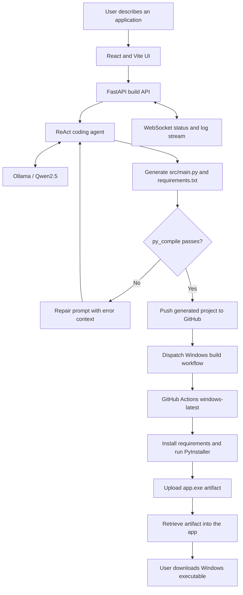

# Magnetar EXE Builder

**Natural-language application generation with a ReAct coding agent, live build telemetry, and native Windows packaging through GitHub Actions.**

[](https://www.python.org/)
[](https://fastapi.tiangolo.com/)
[](https://vitejs.dev/)
[](https://pyinstaller.org/)
[](https://github.com/shubham-61291/agentic-exe-builder_1/actions)

Magnetar EXE Builder accepts an application's requirements in plain English, uses an LLM-backed coding agent to produce a Python project, checks the generated source, and packages the result as an executable. The demonstrated end-to-end design delegates native Windows packaging to a GitHub Actions runner rather than attempting to produce a Windows binary inside a Linux container.

> **Implementation-status note:** The portfolio's documented end-to-end flow includes pushing generated source to GitHub, dispatching a Windows workflow, and retrieving its artifact. In the currently checked-in `05-magnetar-exe-builder` source snapshot, `ReActExeAgent.run_pipeline()` calls an in-process PyInstaller builder; the remote GitHub dispatch and artifact-retrieval handoff are not wired into that path. The companion Windows workflow exists in [`agentic-exe-builder_1`](https://github.com/shubham-61291/agentic-exe-builder_1). This README documents both the demonstrated architecture and the checked-in implementation so the two are not confused.

## Contents

- [At a glance](#at-a-glance)
- [Capabilities](#capabilities)
- [Architecture and build lifecycle](#architecture-and-build-lifecycle)
- [Windows packaging workflow](#windows-packaging-workflow)
- [Technology stack](#technology-stack)
- [Screenshots](#screenshots)
- [Repository structure](#repository-structure)
- [Run locally](#run-locally)
- [Docker Compose](#docker-compose)
- [API reference](#api-reference)
- [Configuration](#configuration)
- [Engineering challenges and decisions](#engineering-challenges-and-decisions)
- [Limitations and security](#limitations-and-security)
- [Author](#author)
- [License](#license)

## At a glance

| Area | Implementation |
|---|---|
| User input | Plain-language application requirements |
| Frontend | React, Vite, Tailwind CSS |
| Backend | FastAPI and Uvicorn |
| Agent | ReAct-style coding agent with file read/write tools |
| Model runtime | Ollama; optional OpenAI provider |
| Generated project | `src/main.py` and `requirements.txt` per run |
| Sanity check | `python -m py_compile src/main.py` |
| Repair loop | Bounded patch attempts after syntax-check failures |
| Live updates | WebSocket build status, logs, and source previews |
| Windows packaging | GitHub Actions `windows-latest` runner with PyInstaller in the companion workflow |
| Companion build repository | [`shubham-61291/agentic-exe-builder_1`](https://github.com/shubham-61291/agentic-exe-builder_1) |
| Main repository folder | [`production-ai-engineering/05-magnetar-exe-builder`](https://github.com/shubham-61291/production-ai-engineering/tree/main/05-magnetar-exe-builder) |

## Capabilities

- **Natural-language app generation:** describe the application's purpose, interface, behavior, and expected outputs.
- **Tool-based file generation:** the agent creates source and dependency files in a per-run workspace using file tools.
- **Syntax validation:** generated Python is checked with `py_compile` before packaging.
- **Bounded repair rounds:** syntax errors are fed back to the agent for a limited number of repair attempts.
- **Live build observability:** the interface receives status and log updates over WebSockets and can show generated source and dependencies.
- **Model/provider settings:** configure the Ollama endpoint and model, or select the supported OpenAI provider.
- **Build tracking and download:** query a run's state and download a binary when one is available in that run's release directory.
- **Windows-native packaging design:** the demonstrated remote workflow runs on GitHub's Windows runner and uploads `app.exe` as an artifact.

The generated output is an application scaffold, not a guarantee of production-ready software. Syntax validation alone does not establish that the program starts correctly, its features work, or its dependencies are safe.

## Architecture and build lifecycle

### Demonstrated end-to-end workflow



### Build lifecycle

1. The user submits an application specification through the web UI.
2. The backend creates a run and asks the coding agent to generate the source and dependency list.
3. The agent uses its file tools to write `src/main.py` and `requirements.txt`.
4. The backend checks Python syntax with `py_compile`.
5. If the check fails, the agent receives the diagnostic context and attempts a bounded repair.
6. In the demonstrated remote-packaging architecture, the generated project is pushed to GitHub and the Windows workflow is dispatched.
7. The Windows runner installs the required packages and runs PyInstaller to produce `app.exe`.
8. The resulting workflow artifact is retrieved and made available to the user.

**Code snapshot distinction:** Steps 6–8 describe the documented remote-build workflow. The current `05-magnetar-exe-builder` source snapshot instead invokes the local `build_executable_in_code()` function after syntax validation. That function runs PyInstaller in the backend's own operating-system environment. The remote push/dispatch/retrieve orchestration needs to be integrated into this source path for the complete flow above to execute automatically from this folder.

## Windows packaging workflow

The companion repository contains the Windows packaging workflow:

- **Repository:** [`agentic-exe-builder_1`](https://github.com/shubham-61291/agentic-exe-builder_1)
- **Workflow file:** [`.github/workflows/build-exe.yml`](https://github.com/shubham-61291/agentic-exe-builder_1/blob/main/.github/workflows/build-exe.yml)
- **Trigger:** `workflow_dispatch`
- **Runner:** `windows-latest`
- **Python:** 3.11
- **Packager:** PyInstaller
- **Artifact name:** `windows-exe`
- **Expected artifact path:** `dist/app.exe`

The companion workflow checks out the repository, sets up Python, upgrades `pip`, installs PyInstaller and any packages listed in `requirements.txt`, packages `src/main.py`, and uploads `dist/app.exe` as a workflow artifact.

### Dispatch requirements

A workflow-dispatch request must include the workflow's required inputs. In the documented integration, a request that supplied only `ref: main` failed with HTTP 422 because the required `branch` input was missing. The corrected payload included both the ref and input:

```json
{
  "ref": "main",
  "inputs": {
    "branch": "main"
  }
}
```

The exact payload must match the workflow definition deployed in the companion repository. Keep GitHub credentials in environment variables or a secret manager; never commit a personal access token to source control.

### Why use a Windows runner?

PyInstaller packages an application for the operating system on which it runs. Running the in-process builder inside a Linux Docker container does not produce a native Windows `.exe`. Delegating packaging to `windows-latest` is the platform-correct approach for a native Windows artifact.

## Technology stack

| Layer | Technology | Role |
|---|---|---|
| Backend | Python, FastAPI, Uvicorn | Build API, run state, WebSocket updates |
| Frontend | React, Vite, Tailwind CSS | Requirements form, settings, live build interface |
| Agent | LangChain tool calling and ReAct-style loop | Source generation and bounded repairs |
| Model serving | Ollama | Local model inference |
| Default model in the checked-in configuration | `qwen2.5-coder:32b` | Default model name in the current source snapshot |
| Model used in the documented tool-calling setup | `qwen2.5:32b` | Base-model configuration used to address tool-calling compatibility in the demonstrated setup |
| Validation | Python `py_compile` | Syntax check before packaging |
| Packaging | PyInstaller | Creates an executable from the generated Python entry point |
| Remote CI | GitHub Actions | Native Windows packaging in the companion repository |
| Local development | Docker, Docker Compose, shell/PowerShell launchers | Run the app in local development environments |
| Demonstration infrastructure | Google Cloud GPU VM with NVIDIA L4, as described in the portfolio README | Host local LLM inference |

### Model configuration note

The portfolio documentation records that `qwen2.5-coder:32b` did not reliably invoke the required file tools in the demonstrated Ollama setup, so the working tool-calling configuration was changed to `qwen2.5:32b`. The checked-in configuration in this monorepo snapshot currently defaults to `qwen2.5-coder:32b`. If file operations are skipped or the agent claims to have finished without writing files, verify the model configured in the UI and backend before debugging the build pipeline.

## Screenshots

Screenshots committed with this project are referenced below.

### Main interface


### Application requirements


### Build progress and status


### Generated application example


The portfolio README describes demonstrated outputs including a Snake game, browser-related applications, PDF tools, and other applications generated from natural-language requirements. Inspect the source and run each output before relying on it.

## Repository structure

```text
05-magnetar-exe-builder/
├── README.md
├── Dockerfile
├── docker-compose.yml
├── start.ps1
├── start.sh
├── backend/
│   ├── requirements.txt
│   └── app/
│       ├── __init__.py
│       ├── main.py
│       ├── config.py
│       └── agent/
│           ├── engine.py
│           ├── exe_builder.py
│           ├── sanity.py
│           └── utils.py
├── frontend/
│   ├── index.html
│   ├── package.json
│   └── src/
│       ├── main.jsx
│       ├── App.jsx
│       └── components/
├── build1.png
├── build2.png
├── build3.png
└── build4.png
```

The repository also contains generated frontend assets and dependency/cache directories. They are omitted from the overview above because they are build output rather than core source files.

## Run locally

### Prerequisites

- Python 3.11 or a compatible version supported by the backend dependencies.
- Node.js and npm for the frontend.
- Ollama running locally or reachable from the backend.
- A model pulled into Ollama that is compatible with the configured tool-calling behavior. The checked-in source defaults to `qwen2.5-coder:32b`; the documented setup used `qwen2.5:32b` to address file-tool compatibility.
- Sufficient memory/VRAM for the selected model. A 32B model can require substantial resources.

### 1. Clone the monorepo

```bash
git clone https://github.com/shubham-61291/production-ai-engineering.git
cd production-ai-engineering/05-magnetar-exe-builder
```

### 2. Start Ollama and pull the model

For the current checked-in default:

```bash
ollama pull qwen2.5-coder:32b
```

For the base-model configuration documented as more reliable for tool calling:

```bash
ollama pull qwen2.5:32b
```

Use the model name that matches your application settings. Ensure the Ollama API is reachable at the configured base URL before starting a build.

### 3. Start the application on Windows

From PowerShell in the project directory:

```powershell
.\start.ps1
```

The launcher is intended to start the backend and frontend development servers. If a local setup differs, check the launcher and its terminal output for the actual ports. In the checked-in development configuration, the API uses port `8000` and the Vite frontend uses port `3000`.

### 4. Start the application on Linux

```bash
chmod +x start.sh
./start.sh
```

The development frontend proxies `/api` and `/ws` requests to the FastAPI backend. Confirm that both processes start successfully before submitting a build.

### 5. Generate an application

1. Open `http://localhost:3000`.
2. Enter a specific application requirement, including desired behavior and key interactions.
3. Check the model and provider in settings.
4. Start the build and observe the live status and log output.
5. Inspect the generated source and `requirements.txt` before running the result.
6. Download the executable when the run reports it is ready and a binary is available.

Example prompt:

```text
Create a Snake game with arrow-key controls, a visible score, collision detection,
restart functionality, and retro styling. Generate the entry point at src/main.py
and include any required Python dependencies in requirements.txt.
```

## Docker Compose

The checked-in Compose configuration builds and runs the backend service on port `8000`:

```bash
docker compose up -d --build
docker compose logs -f app
```

The Compose service points Ollama at the host using `http://host.docker.internal:11434` and adds a host-gateway mapping for that hostname. Confirm that Ollama is running on the host and that the container can reach it.

**Frontend note:** The Compose file defines the backend service only. The Dockerfile builds frontend assets, but the checked-in FastAPI entry point does not serve the compiled frontend directory as a website. For the full UI during development, use `start.ps1` or `start.sh`, or add and validate a static-file/reverse-proxy configuration for the deployment you intend to use.

**Windows build note:** The in-process PyInstaller path produces a binary for the backend's operating system. A Linux container cannot produce a native Windows `.exe` using that path. Use the companion GitHub Actions Windows workflow for Windows-native packaging; the remote handoff is not currently wired into the local build path in this source snapshot.

## API reference

The API listens on port `8000` by default.

| Method | Endpoint | Purpose |
|---|---|---|
| `GET` | `/api/health` | Reports application/model health information and whether the configured Ollama endpoint responds |
| `POST` | `/api/build` | Starts a generation/build run and returns a `run_id` |
| `GET` | `/api/runs/{run_id}` | Retrieves run state, logs, generated source/dependencies when available, and executable readiness |
| `GET` | `/api/download/{run_id}` | Downloads a binary found in that run's `release` directory |
| `WS` | `/ws/build/{run_id}` | Streams status, logs, source previews, and readiness updates |

### Start a build

```bash
curl -X POST http://127.0.0.1:8000/api/build \
  -H "Content-Type: application/json" \
  -d '{
    "requirements": "Create a desktop calculator with keyboard support and a clear display.",
    "provider": "ollama",
    "model": "qwen2.5:32b",
    "base_url": "http://localhost:11434",
    "api_key": ""
  }'
```

The response includes a `run_id`. Check the run status with:

```bash
curl http://127.0.0.1:8000/api/runs/<run_id>
```

If the run contains a downloadable binary, use:

```text
http://127.0.0.1:8000/api/download/<run_id>
```

This download endpoint searches the local run directory. It should not be interpreted as proof that remote GitHub Actions artifacts are being retrieved automatically by the current checked-in orchestration.

## Configuration

The current backend configuration includes the following settings. Defaults can differ between the backend configuration, UI settings, and the environment in which the service is launched; verify the actual effective values when troubleshooting.

| Variable | Default / behavior | Purpose |
|---|---|---|
| `OLLAMA_BASE_URL` | `http://localhost:11434` in backend configuration; Compose targets `http://host.docker.internal:11434` | Ollama endpoint |
| `OLLAMA_MODEL` | `qwen2.5-coder:32b` in the checked-in configuration | Default local model |
| `DEFAULT_PROVIDER` | `ollama` | Default provider (`ollama` or `openai`) |
| `OPENAI_API_KEY` | Empty unless supplied | Credential for the optional OpenAI provider |
| `OPENAI_MODEL` | `gpt-4o-mini` | Default OpenAI model when selected |
| `MAX_REACT_STEPS` | `18` | Maximum agent tool-calling steps per phase |
| `MAX_PATCH_ROUNDS` | `4` | Maximum repair rounds after syntax-check failures |
| `WORKSPACE_DIR` | Backend-defined workspace directory | Parent directory for per-run workspaces |
| `COPYRIGHT_LINE` | `© 2026 Shubham Singh. All rights reserved.` | Visible copyright line instructed for generated applications |

The UI can supply model/provider settings for a specific build. Never put live API keys or GitHub tokens in source code or commit them to the repository.

## Engineering challenges and decisions

The portfolio's project notes document the following engineering lessons from the demonstrated build environment.

### 1. Cross-platform compilation

**Problem:** PyInstaller running in a Linux container cannot create a native Windows executable.

**Decision:** Use a `windows-latest` GitHub Actions runner for the native Windows packaging stage. Keep this remote packaging stage distinct from the in-process builder currently present in the monorepo source snapshot.

### 2. Model tool-calling compatibility

**Problem:** The specialized `qwen2.5-coder:32b` model was reported to fail to reliably execute the file-writing/reading tools in the demonstrated Ollama setup.

**Decision:** The documented working configuration switched to `qwen2.5:32b`. If an agent says it completed the task but the files were not created, verify tool calls and model compatibility before proceeding to compilation.

### 3. Stale Docker layers

**Problem:** Docker's build cache can preserve an older build engine or application code after changes.

**Troubleshooting:**

```bash
docker compose build --no-cache
docker compose up -d
```

Use `docker cp` only when intentionally replacing a file inside an existing container for diagnosis; rebuild the image and recreate the container for a reproducible deployment.

### 4. Missing destination directory

**Problem:** Copying generated source can fail when the destination directory does not exist.

**Defensive pattern:**

```python
os.makedirs(os.path.dirname(dst), exist_ok=True)
```

Ensure the destination directory exists before copying generated files into the packaging workspace.

### 5. GitHub workflow dispatch returns HTTP 422

**Problem:** The workflow requires a `branch` input in addition to the workflow ref.

**Decision:** Send the required input exactly as declared in the deployed workflow definition. The documented payload includes both `ref: "main"` and `inputs: {"branch": "main"}`.

### 6. Reverse-proxy configuration resets

The broader deployment notes describe Nginx configuration reverting to its default after a container rebuild, which removed `/api/` and `/ws/` proxy rules. The deployment-level fix was to mount a maintained custom `nginx.conf` through Docker Compose. **The current `05-magnetar-exe-builder` folder does not include that Nginx configuration**, so apply this lesson only if adding the same reverse-proxy layer to your deployment.

## Limitations and security

- **Syntax is not correctness:** `py_compile` catches Python syntax errors; it does not test UI interactions, business logic, runtime imports, network calls, or packaging behavior.
- **Bounded repairs:** a build can still fail after the configured patch-round limit.
- **Platform-specific local builds:** local PyInstaller output matches the backend's operating system. Native Windows packaging requires Windows, such as the companion Actions workflow.
- **Workflow integration gap in this snapshot:** remote GitHub push, dispatch, and artifact retrieval are described in the documented architecture but are not called by the current `ReActExeAgent.run_pipeline()` in this folder.
- **In-memory run state:** run records and WebSocket subscriber state are held in process memory; restarting the backend may lose state even if files remain on disk.
- **MVP concurrency model:** background tasks are not a durable distributed job queue.
- **Model-dependent quality:** results depend on model behavior, available compute, prompt quality, and tool-calling compatibility.
- **Generated dependencies:** generated packages may be incompatible, malicious, or unnecessary. Review the source and dependency list before installation or execution.
- **Unsigned executables:** the project does not sign generated executables; Windows SmartScreen or endpoint protection may warn users.
- **Network exposure:** the checked-in API configuration uses permissive CORS and does not provide authentication for build endpoints. Do not expose the API to an untrusted network without adding authentication, rate limiting, user/run isolation, request validation, resource limits, and cleanup policies.
- **Credential handling:** use narrowly scoped GitHub credentials and store them as secrets. A token used for workflow dispatch, repository writes, or artifact downloads must have only the permissions that workflow actually needs.
- **External model providers:** when the OpenAI provider is selected, prompts and generation context are sent to that provider. Do not submit confidential content unless that disclosure is intended.
- **Repository hygiene:** generated frontend assets, dependency folders, and Python bytecode appear in the repository tree; avoid committing generated dependencies and caches in a cleaned-up distribution.
- **License file:** The MIT terms are included at the end of this README. For standard repository-level license detection, keep a root-level `LICENSE` file containing the same text.

## Author

**Shubham Kumar Singh**

- GitHub: [@shubham-61291](https://github.com/shubham-61291)
- Monorepo: [`production-ai-engineering`](https://github.com/shubham-61291/production-ai-engineering)
- Project: [`05-magnetar-exe-builder`](https://github.com/shubham-61291/production-ai-engineering/tree/main/05-magnetar-exe-builder)
- Companion Windows workflow: [`agentic-exe-builder_1`](https://github.com/shubham-61291/agentic-exe-builder_1)

## License

This project is licensed under the MIT License.

Copyright (c) 2026 Shubham Kumar Singh

Permission is hereby granted, free of charge, to any person obtaining a copy
of this software and associated documentation files (the "Software"), to deal
in the Software without restriction, including without limitation the rights
to use, copy, modify, merge, publish, distribute, sublicense, and/or sell
copies of the Software, and to permit persons to whom the Software is
furnished to do so, subject to the following conditions:

The above copyright notice and this permission notice shall be included in all
copies or substantial portions of the Software.

THE SOFTWARE IS PROVIDED "AS IS", WITHOUT WARRANTY OF ANY KIND, EXPRESS OR
IMPLIED, INCLUDING BUT NOT LIMITED TO THE WARRANTIES OF MERCHANTABILITY,
FITNESS FOR A PARTICULAR PURPOSE AND NONINFRINGEMENT. IN NO EVENT SHALL THE
AUTHORS OR COPYRIGHT HOLDERS BE LIABLE FOR ANY CLAIM, DAMAGES OR OTHER
LIABILITY, WHETHER IN AN ACTION OF CONTRACT, TORT OR OTHERWISE, ARISING FROM,
OUT OF OR IN CONNECTION WITH THE SOFTWARE OR THE USE OR OTHER DEALINGS IN THE
SOFTWARE.
