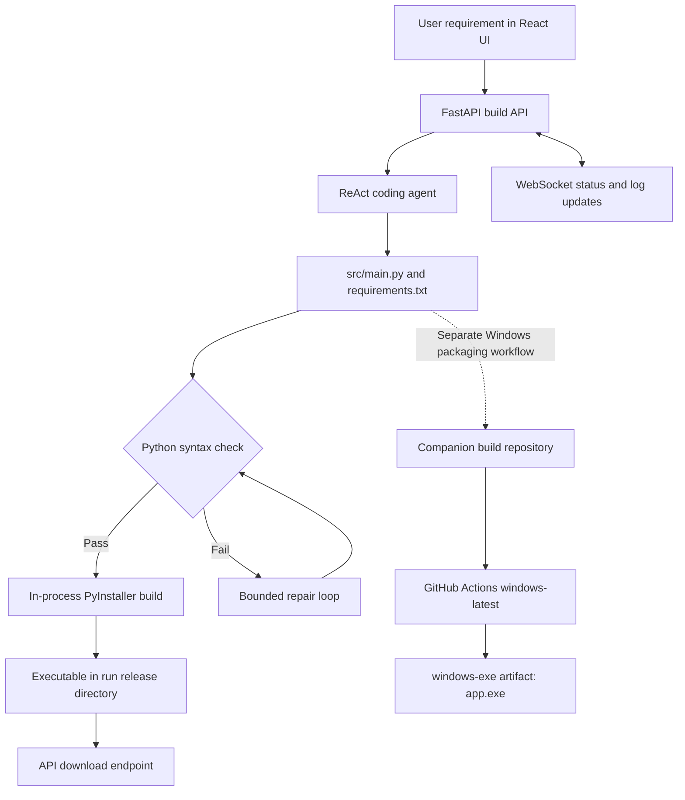
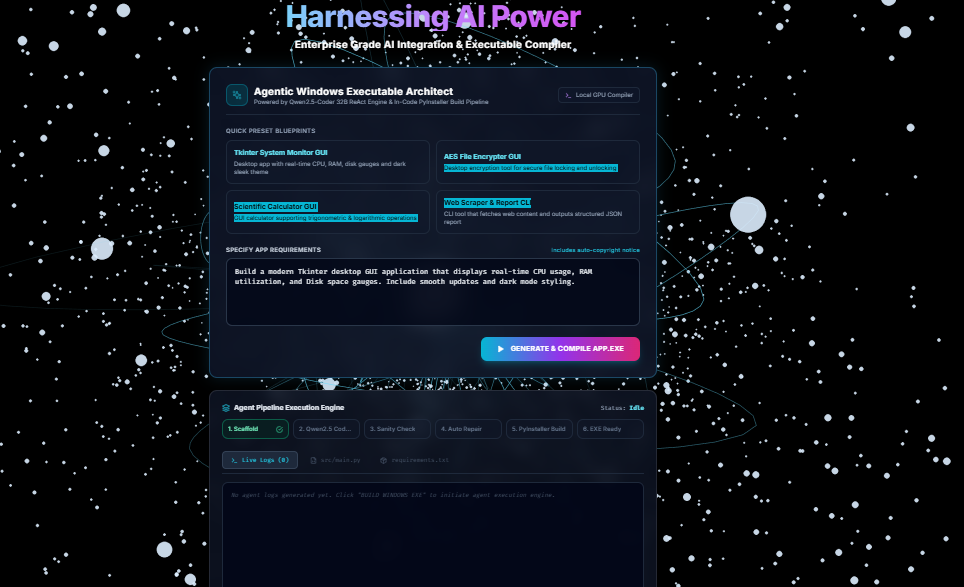
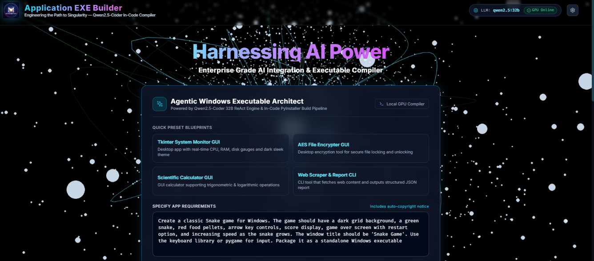
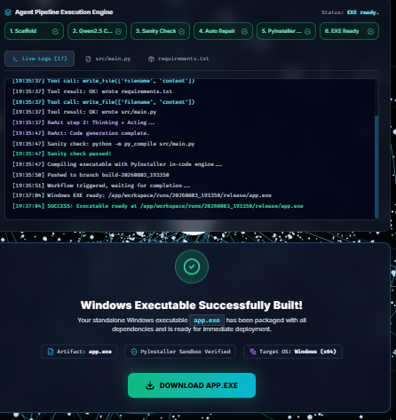
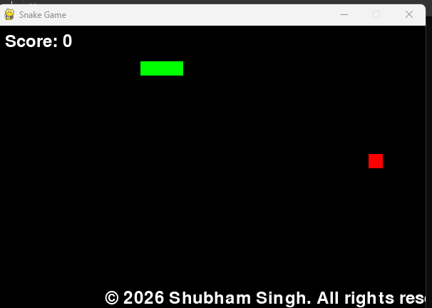

# Magnetar EXE Builder

**AI-assisted application generation with a ReAct coding agent, live build telemetry, and Windows executable packaging.**

[](https://www.python.org/)
[](https://vitejs.dev/)
[](https://github.com/shubham-61291/agentic-exe-builder_1)

Magnetar EXE Builder turns a plain-language application specification into Python source code and a dependency list. A ReAct-style agent writes files into an isolated per-run workspace, performs a Python syntax check, and attempts bounded repairs when the check fails. The generated project can then be packaged as an executable.

The project has used a **GitHub Actions Windows build workflow** hosted in a separate repository. The current `05-magnetar-exe-builder` source snapshot also contains an in-process PyInstaller builder. These are distinct build paths and are documented separately below so the setup and platform limitations remain clear.

> **Project boundary:** This is an AI-assisted MVP, not a general-purpose software engineer. `py_compile` checks Python syntax; it does not prove runtime correctness, UI behavior, dependency compatibility, or security. Review generated source and dependencies before running them.

## Contents

- [At a glance](#at-a-glance)
- [Capabilities](#capabilities)
- [Architecture](#architecture)
- [Build paths: local and GitHub Actions](#build-paths-local-and-github-actions)
- [Technology stack](#technology-stack)
- [Screenshots](#screenshots)
- [Repository layout](#repository-layout)
- [Run locally](#run-locally)
- [Docker Compose](#docker-compose)
- [API reference](#api-reference)
- [Configuration](#configuration)
- [Validation and limitations](#validation-and-limitations)
- [Security notes](#security-notes)
- [Author](#author)
- [License](#license)

## At a glance

| Capability | Implementation |
|---|---|
| Input | Plain-English application requirements |
| Code generation | ReAct-style agent with file-writing and file-reading tools |
| Default model | `qwen2.5-coder:32b` through Ollama |
| Optional model provider | OpenAI-compatible chat models, including `gpt-4o-mini` by default when selected |
| Generated files | `src/main.py` and `requirements.txt` per run |
| Pre-build check | `python -m py_compile src/main.py` |
| Repair behavior | Up to four patch rounds by default |
| Live updates | WebSocket messages for status, logs, and generated source previews |
| In-process packaging | PyInstaller runs in the backend's operating-system environment |
| Windows packaging workflow | Companion repository with a `windows-latest` GitHub Actions workflow and `windows-exe` artifact |
| Interface | React, Vite, Tailwind CSS, and FastAPI |

## Capabilities

- **Natural-language application generation:** describe the desktop application's purpose, UI, behavior, and expected outputs.
- **Tool-based code generation:** the agent uses `write_file` and `read_file` tools to create `src/main.py` and `requirements.txt` in the current run workspace.
- **Syntax gate:** generated Python is checked with `py_compile` before packaging.
- **Bounded repair loop:** when the syntax check fails, the agent receives the error context and attempts a repair. The default maximum is four patch rounds.
- **Live build visibility:** the interface receives status and log updates over WebSockets and can display generated source and the dependency list.
- **Executable download:** once an executable exists in a run's `release` directory, the API exposes it through the download endpoint.
- **Provider selection:** the UI can select Ollama or OpenAI and configure the model and endpoint.
- **Run isolation:** each build receives a separate workspace under the configured runs directory.

## Architecture



The checked-in FastAPI agent path and the remote GitHub Actions Windows packaging path should not be mistaken for the same execution path. Details of each are provided in the next section.

## Build paths: local and GitHub Actions

### In-process build in this repository

The checked-in `backend/app/agent/engine.py` calls `build_executable_in_code()` after syntax validation. That function invokes PyInstaller inside the environment running the backend and places its output in the run's `release` directory.

PyInstaller targets the **current operating system**. Therefore, running this in a Linux container creates a Linux executable, not a native Windows `.exe`. For a local Windows `.exe` through this path, run the backend and compilation environment on Windows.

### GitHub Actions Windows build

The project has also used a separate Windows packaging repository:

- **Build repository:** [`shubham-61291/agentic-exe-builder_1`](https://github.com/shubham-61291/agentic-exe-builder_1)
- **Workflow:** [`build-exe.yml`](https://github.com/shubham-61291/agentic-exe-builder_1/blob/main/.github/workflows/build-exe.yml)
- **Runner:** `windows-latest`
- **Python:** 3.11
- **Packager:** PyInstaller
- **Artifact:** `windows-exe`, containing `dist/app.exe`

The workflow is manually dispatched. It checks out the generated project, installs Python and PyInstaller plus any packages listed in `requirements.txt`, runs the PyInstaller command, and uploads `dist/app.exe` as the `windows-exe` artifact.

A remote-build orchestration must push the generated `src/main.py` and `requirements.txt` to the build repository, dispatch the workflow, wait for completion, then download and extract the `windows-exe` artifact. The related Build2EXE workflow demonstrates that pattern. **That remote repository handoff is not called by the current `ReActExeAgent.run_pipeline()` in this directory**, which currently calls the in-process PyInstaller builder instead. Treat the Actions route as the separate Windows packaging workflow unless/until the handoff is integrated into this code path.

## Technology stack

| Layer | Technology |
|---|---|
| Backend API | Python 3.11 container image, FastAPI, Uvicorn |
| Agent orchestration | LangChain tool calling; ReAct-style agent logic |
| Model runtime | Ollama using the OpenAI-compatible `/v1` endpoint by default |
| Default model | `qwen2.5-coder:32b` |
| Optional model provider | OpenAI-compatible provider through `langchain-openai` |
| Frontend | React 18, Vite 5, Tailwind CSS |
| Live updates | WebSockets |
| Validation | Python `py_compile` |
| Packaging | PyInstaller; GitHub Actions Windows packaging in the companion workflow |
| Containerization | Docker and Docker Compose |

## Screenshots

The following screenshots are stored in the repository root and rendered directly by GitHub.

### Main interface



### Entering application requirements



### Build log and executable status



### Generated application example



## Repository layout

```text
05-magnetar-exe-builder/
├── README.md
├── Dockerfile
├── docker-compose.yml
├── start.ps1
├── start.sh
├── backend/
│   ├── requirements.txt
│   └── app/
│       ├── main.py
│       ├── config.py
│       └── agent/
│           ├── engine.py
│           ├── exe_builder.py
│           ├── sanity.py
│           └── utils.py
├── frontend/
│   ├── package.json
│   ├── index.html
│   └── src/
│       ├── main.jsx
│       ├── App.jsx
│       └── components/
├── build1.png
├── build2.png
├── build3.png
└── build4.png
```

The repository also contains generated frontend assets and Python bytecode. Those generated directories are omitted from the structural overview above.

## Run locally

### Prerequisites

- Python 3.11 or compatible Python installation for the backend.
- Node.js and npm for the React/Vite frontend.
- Ollama installed and running, with a model available locally; the default is `qwen2.5-coder:32b`.
- Sufficient RAM/VRAM for the selected model. The 32B model can require substantial system resources.

### 1. Clone the repository

```bash
git clone https://github.com/shubham-61291/production-ai-engineering.git
cd production-ai-engineering/05-magnetar-exe-builder
```

### 2. Start Ollama and pull the default model

In a separate terminal, ensure Ollama is running and pull the configured model:

```bash
ollama pull qwen2.5-coder:32b
```

If Ollama is running on a different host or port, update `OLLAMA_BASE_URL` or specify the URL in the UI settings.

### 3. Start the application on Windows

From PowerShell in the project directory:

```powershell
.\start.ps1
```

The launcher starts the FastAPI backend on `http://127.0.0.1:8000` and the Vite development server on `http://127.0.0.1:3000`. Open the frontend at `http://localhost:3000`.

### 4. Start the application on Linux

```bash
chmod +x start.sh
./start.sh
```

The launcher starts the API on `127.0.0.1:8000` and Vite on port `3000`. The checked-in Vite configuration proxies `/api` and `/ws` requests to the backend on port `8000`.

### 5. Generate an application

1. Open `http://localhost:3000`.
2. Enter the requirements for the application.
3. Review the selected model provider and model in settings if necessary.
4. Start the build and follow the live status and logs.
5. Inspect the generated source and requirements.
6. Download the resulting binary once the build reports completion.

Example requirement:

```text
Create a Snake game with arrow-key controls, score display, collision detection,
restart functionality, and retro styling. Include a clear help message and keep
all generated source in src/main.py.
```

## Docker Compose

The repository includes a Compose service that builds the backend image and exposes port `8000`:

```bash
docker compose up -d --build
docker compose logs -f app
```

The Compose configuration points the container at the host's Ollama service using `host.docker.internal:11434`. On Linux, the Compose file adds the host-gateway mapping for that hostname.

**Frontend note:** Compose defines only the `app` service. Although the Dockerfile builds the frontend and copies its assets into `frontend_dist`, the checked-in FastAPI entry point does not mount or serve that directory. Use the local launcher for the Vite UI, or add a static-file/proxy serving configuration before expecting the UI to be available from the Compose port alone.

**Build target note:** The in-process PyInstaller path uses the container's operating system. A Linux container does not produce a native Windows `.exe`; use the separate GitHub Actions Windows packaging workflow or run the in-process build on Windows.

## API reference

The API listens on port `8000` by default.

| Method | Endpoint | Purpose |
|---|---|---|
| `GET` | `/api/health` | Reports configured model details and whether the configured Ollama endpoint responds |
| `POST` | `/api/build` | Starts a generation/build run and returns a `run_id` |
| `GET` | `/api/runs/{run_id}` | Retrieves the run state, logs, generated source/dependencies when available, and executable readiness |
| `GET` | `/api/download/{run_id}` | Downloads the binary found in that run's `release` directory |
| `WS` | `/ws/build/{run_id}` | Streams run status, logs, source previews, and executable readiness updates |

### Example: start a build

```bash
curl -X POST http://127.0.0.1:8000/api/build \
  -H "Content-Type: application/json" \
  -d '{
    "requirements": "Create a desktop calculator with keyboard support and a clear display.",
    "provider": "ollama",
    "model": "qwen2.5-coder:32b",
    "base_url": "http://localhost:11434",
    "api_key": ""
  }'
```

A successful response returns a `run_id`. Use it to check progress:

```bash
curl http://127.0.0.1:8000/api/runs/<run_id>
```

When the run has a binary in its release directory, download it with:

```text
http://127.0.0.1:8000/api/download/<run_id>
```

For the separate GitHub Actions workflow, artifact retrieval is a distinct step performed by the orchestration that dispatches the remote workflow; the local download endpoint above reads the local run directory.

## Configuration

The backend reads configuration from environment variables. The checked-in defaults are:

| Variable | Default | Purpose |
|---|---|---|
| `OLLAMA_BASE_URL` | `http://localhost:11434` | Ollama base URL |
| `OLLAMA_MODEL` | `qwen2.5-coder:32b` | Default local model |
| `OPENAI_API_KEY` | empty | Optional key for the OpenAI provider |
| `OPENAI_MODEL` | `gpt-4o-mini` | Default model when OpenAI is selected |
| `DEFAULT_PROVIDER` | `ollama` | Default provider (`ollama` or `openai`) |
| `MAX_REACT_STEPS` | `18` | Maximum tool-calling steps per agent phase |
| `MAX_PATCH_ROUNDS` | `4` | Maximum repair rounds after syntax-check failures |
| `WORKSPACE_DIR` | backend workspace directory | Parent directory for generated runs |
| `COPYRIGHT_LINE` | `© 2026 Shubham Singh. All rights reserved.` | Required visible copyright line instructed in generated applications |

The UI allows model/provider settings to be supplied for an individual build. Do not place real API keys in source code or commit them to the repository. For the Docker Compose service, the Ollama URL defaults to `http://host.docker.internal:11434`.

## Validation and limitations

- **Syntax validation only:** `py_compile` catches syntax errors; it does not test application behavior, UI flows, calculations, or runtime imports.
- **Bounded repair:** the default limit is four patch rounds. A generation may fail after that limit.
- **Local build is platform-dependent:** local PyInstaller packaging targets the OS running the backend.
- **GitHub Actions is a separate build path:** the companion workflow runs on `windows-latest`, uses Python 3.11 and PyInstaller, and uploads the `windows-exe` artifact. The current `ReActExeAgent` code in this directory calls the local PyInstaller implementation; the remote repository dispatch/artifact retrieval is not wired into this code path in the checked-in snapshot.
- **In-memory run state:** run tracking and WebSocket subscriber lists are stored in process memory. Restarting the backend loses the in-memory state even if some run files remain on disk.
- **Concurrent jobs:** the API starts work in background tasks, but it is an MVP rather than a durable distributed job queue.
- **Model availability:** output quality and generation time depend on the chosen model, hardware, endpoint, and prompt clarity.
- **Generated app dependencies:** dependency installation may fail or produce incompatible packages. Inspect generated `requirements.txt` and application code before use.
- **Unsigned executables:** generated programs are not code-signed by this project. Windows SmartScreen or endpoint security software may display warnings.
- **Repository hygiene:** the visible repository tree includes `frontend/node_modules`, built `frontend/dist` assets, and Python `__pycache__` files. A clean development distribution should exclude generated dependencies and bytecode from source control.
- **License file:** the existing README declares MIT, but a `LICENSE` file was not found in this project directory. Include the full license text before relying on the notice for redistribution.

## Security notes

- Generated code is executable code. Review the source and dependency list before running the output, especially if requirements involve file access, network operations, credentials, subprocesses, or system changes.
- Do not build untrusted prompts on a machine that has privileged credentials or sensitive files available to the generated program.
- Keep Ollama and the API bound to trusted interfaces. The API currently configures permissive CORS (`*`) and does not implement authentication for build endpoints; do not expose it directly to an untrusted network.
- The optional OpenAI provider sends the prompt and generation context to the configured OpenAI service. Do not include secrets or private data in requirements unless that disclosure is intended.
- Treat GitHub tokens and workflow credentials as secrets. Use a dedicated token with only the permissions required to push generated branches, dispatch the build workflow, and download artifacts.
- Before using a public build endpoint, add authentication, rate limiting, isolation between users, cleanup policies, and resource limits for model calls and compilation.

## Author

**Shubham Kumar Singh**

- GitHub: [@shubham-61291](https://github.com/shubham-61291)
- Project repository: [production-ai-engineering/05-magnetar-exe-builder](https://github.com/shubham-61291/production-ai-engineering/tree/main/05-magnetar-exe-builder)
- Companion Windows packaging workflow: [agentic-exe-builder_1](https://github.com/shubham-61291/agentic-exe-builder_1)

## License

The existing project README declares the MIT License. However, the project directory inspected for this README did not contain a `LICENSE` file. Add the complete MIT License text to the repository before relying on that declaration for redistribution.
