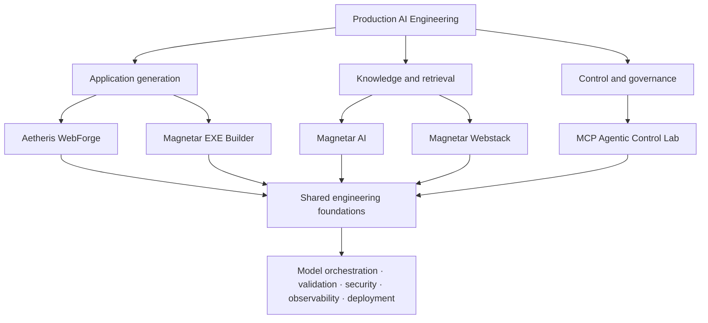

# Production AI Engineering

### A portfolio of five applied AI systems, from local inference to guarded workflows and deployable artifacts

**Production AI Engineering** is a multi-project repository exploring the engineering required to turn language-model capabilities into usable applications. It brings together application generation, document-grounded retrieval, agent/tool control, AI security, observability, container deployment, and native Windows packaging.

Rather than treating an LLM call as the whole product, the projects focus on the systems around it: orchestration, retrieval, authorization, validation, failure handling, deployment, and execution evidence.

> **Scope and status:** These are engineering projects and demonstrations, not a blanket claim of security certification or production readiness. Each system has its own setup instructions and limitations. The repository-state notes below call out known implementation gaps where the checked-in source differs from the intended or demonstrated architecture.

## Portfolio at a glance

| # | Project | What it explores | Core technologies | Project guide |
|---|---|---|---|---|
| 01 | **Aetheris WebForge** | Natural-language requirements to previewable, downloadable web applications, with optional Google Cloud Storage publishing | Python, FastAPI, Ollama, HTML/CSS/JavaScript, Google Cloud Storage | [README](./01-aetheris-webforge/README.md) · [Source](./01-aetheris-webforge/) |
| 02 | **Magnetar AI** | Document question-answering with dense and keyword retrieval | FastAPI, React, Ollama, ChromaDB, BM25, Redis | [README](./02-magnetar-ai/README.md) · [Source](./02-magnetar-ai/) |
| 03 | **MCP Agentic Control Lab** | Tool-level authorization and auditability for document-grounded agents | Python, Gradio, MCP-style tools, ChromaDB, Ollama, optional OpenAI API | [README](./03-mcp-agentic-control-lab/README.md) · [Source](./03-mcp-agentic-control-lab/) |
| 04 | **Magnetar Webstack** | Self-hosted assistant, document RAG, and multi-agent contract review | FastAPI, React, TypeScript, Qdrant, LangGraph, Redis, Ollama | [README](./04-magnetar-webstack/README.md) · [Source](./04-magnetar-webstack/) |
| 05 | **Magnetar EXE Builder** | Natural-language application generation and executable packaging | FastAPI, React, Ollama, agent tooling, PyInstaller, GitHub Actions workflow | [README](./05-magnetar-exe-builder/README.md) · [Source](./05-magnetar-exe-builder/) |

## How the projects fit together

The five projects address three related problem areas: generating applications, building knowledge-backed systems, and governing agent/tool execution. They share infrastructure patterns, but they remain separate applications rather than one combined runtime.



## Engineering principles

### Systems around models

The model is one component, not the application architecture. Depending on the project, the execution path also includes input handling, retrieval or tools, validation, output controls, logging, and a user-facing artifact.

### Explicit control boundaries

The projects explore where control should live: in an application layer, a retrieval pipeline, a tool boundary, or a build workflow. In the MCP Agentic Control Lab, for example, write authorization is checked inside the policy-update tool rather than being left solely to the interface.

### Evidence and inspectability

Project folders contain screenshots, test or verification code, and execution-oriented implementation details. Those assets document demonstrations; they should not be read as a substitute for independent security review or a successful deployment in every environment.

### Security as layered controls

Where implemented, the portfolio uses controls such as prompt-injection heuristics, API-key authentication, role checks, rate limiting, PII filtering, secret handling, and audit logging. The controls differ by project, and none should be interpreted as a guarantee that all attacks or sensitive outputs will be prevented.

---

# The systems

## 01 — Aetheris WebForge

**Natural-language web application generation, preview, packaging, and optional cloud publishing.**

Aetheris WebForge turns a natural-language brief into a self-contained HTML application. The generated page can be previewed in the dashboard, packaged for download, and optionally published to Google Cloud Storage. The generation backend supports a configurable model path, including Ollama for local inference and an OpenAI API option.

**Core workflow**

```text
Application brief
      ↓
Model-backed HTML generation
      ↓
Heuristic input/output checks
      ↓
Browser preview ──→ downloadable site bundle
      ↓
Optional Google Cloud Storage publishing
```

**Key capabilities**

- Generate HTML with embedded CSS and JavaScript from a written brief.
- Preview generated pages in the browser.
- Package output as a downloadable site bundle.
- Optionally inject a RAG assistant into generated pages.
- Publish a generated site to Google Cloud Storage when configured.
- Apply heuristic prompt-injection checks and output filtering.

**Technology:** Python, FastAPI, Ollama, optional OpenAI API, HTML/CSS/JavaScript, Docker, Google Cloud Storage.

**Demonstration:** [View the GCP-deployed application screenshot](./01-aetheris-webforge/lov3gcpdeployed.png).

**Status and limitations:** The project README describes this as a demonstration/MVP rather than a security-certified platform. Review generated code and content before public deployment; output quality depends on the selected model, and cloud publishing requires correctly configured Google Cloud permissions and bucket settings.

**Run it:** Start with the [Aetheris WebForge README](./01-aetheris-webforge/README.md), which documents local development, Docker, configuration, cloud publishing, APIs, and tests.

---

## 02 — Magnetar AI

**Self-hosted document question-answering with hybrid retrieval and operational controls.**

Magnetar AI ingests PDF, DOCX, and text documents, retrieves relevant passages using dense vector search and BM25 keyword retrieval, and sends the retrieved context to a language model. A React dashboard supports document and query workflows; the API includes authentication and operational integrations.

**Core workflow**

```text
Documents → extraction → chunking → indexing
                                  ├─ dense retrieval
Question → query processing ─────┤
                                  └─ BM25 keyword retrieval
                                             ↓
                                     ranked evidence
                                             ↓
                                      local LLM
                                             ↓
                               answer with source passages
```

**Key capabilities**

- PDF, DOCX, and text ingestion.
- ChromaDB-based vector retrieval combined with BM25.
- Ranked retrieval results and source-context answers.
- Ollama-based local inference.
- React dashboard and FastAPI backend.
- API-key authentication, rate limiting, health checks, and Redis caching.
- Integration points for telemetry and containerized deployment.

**Technology:** Python, FastAPI, React, Ollama, ChromaDB, BM25, Redis, Docker Compose, and observability integrations.

**Demonstration:** [View a hybrid-RAG screenshot](./02-magnetar-ai/hybridrag1.png).

**Status and limitations:** Retrieval can miss relevant passages, and generated answers can be incomplete or incorrect. The project README notes that there is no cross-encoder reranker and that DOCX table extraction is incomplete. Review source passages before relying on answers for compliance, legal, or other consequential decisions.

**Run it:** Follow the [Magnetar AI README](./02-magnetar-ai/README.md) for environment configuration, local development, Docker Compose, API usage, tests, and deployment notes.

---

## 03 — MCP Agentic Control Lab

**A systems-engineering study of authorization at the agent/tool boundary.**

MCP Agentic Control Lab explores a core question in agentic AI: where should authority and access control be enforced? The application combines document ingestion, semantic retrieval, a policy assistant, role checks, controlled policy updates, and an inspectable audit trail.

**Control flow**

```text
User request
     ↓
Agent / application
     ↓
Authorized tool boundary
     ├─ retrieval tool → policy context
     └─ update tool → role check → policy store
                             ↓
                       audit event
```

**Key capabilities**

- PDF, DOCX, and TXT policy-document ingestion.
- Document-grounded policy question-answering.
- Configured identity mapping to `ADMIN`, `USER`, or `UNKNOWN` roles.
- Tool-level authorization for policy updates.
- Audit records for identity, role, operation, outcome, details, and timestamp.
- ChromaDB by default, with optional Pinecone or in-memory storage paths.
- Ollama inference with an optional OpenAI API fallback.
- Gradio interface and Docker Compose support.

**Technology:** Python, Gradio, semantic embeddings, ChromaDB, optional Pinecone, Ollama, optional OpenAI API, and tool-oriented agent orchestration.

**Demonstration:** [View an MCP control-lab screenshot](./03-mcp-agentic-control-lab/mcp1.png).

**Important scope note:** The current project README states that the checked-in runnable application focuses on the agent → tool → context pattern. Although the project framing discusses MCP-style and MCP-native control as comparison points, this folder does **not** currently contain a distinct, separately runnable MCP-Style implementation. It is also an engineering experiment, not a drop-in identity provider.

**Run it:** See the [MCP Agentic Control Lab README](./03-mcp-agentic-control-lab/README.md) for configuration, supported execution modes, and setup details.

---

## 04 — Magnetar Webstack

**Self-hosted conversational AI, document RAG, and multi-agent contract review.**

Magnetar Webstack brings together a web interface, a FastAPI backend, local model inference, document retrieval, output privacy controls, operational telemetry, and a multi-stage contract-audit workflow.

**Core workflows**

```text
Chat question ─────────────────────→ local LLM → response

Document upload → parsing → embeddings → Qdrant
Question → retrieval from indexed context → local LLM → response

Contract → Junior Auditor → Reflector → Researcher → Revisor → PDF report
```

**Key capabilities described by the project**

- Conversational AI with Ollama-based inference.
- Document question-answering for PDF, DOCX, TXT, and Markdown files.
- Qdrant-backed vector retrieval.
- LangGraph-based, four-stage contract review.
- Report generation with an executive summary, compliance score, flagged clauses, and analysis.
- Prompt-injection guard, PII filtering/redaction, API-key authentication, and rate limiting.
- Redis, OpenTelemetry, Jaeger, and Prometheus integration points.

**Technology:** Python, FastAPI, React, TypeScript, Ollama, Qdrant, Redis, LangChain/LangGraph, Microsoft Presidio, OpenTelemetry, Jaeger, and Prometheus. Tavily is used for the legal-audit web-research stage when configured.

**Demonstration:** [View a Magnetar Webstack screenshot](./04-magnetar-webstack/mws1.png).

**Known repository blocker:** The current project README reports that `app/models/schemas.py` is missing from the checked-in tree even though routers and utility modules import it. That prevents a clean checkout from importing successfully until the module is restored. Treat setup/API documentation as a description of the intended configuration, not as proof that a fresh end-to-end deployment currently works.

**Limitations:** Normal chat/RAG requests do not provide live browsing; the legal audit uses a web-research stage when Tavily is configured. Audit output is informational and does not replace review by a qualified legal professional. Large models may require quantization depending on available GPU memory.

**Run it:** Review the [Magnetar Webstack README](./04-magnetar-webstack/README.md), especially its repository-state caveat, configuration, validation, and security notes.

---

## 05 — Magnetar EXE Builder

**Natural-language application generation with agent-driven coding and executable packaging.**

Magnetar EXE Builder accepts a plain-language application description, generates a Python project through an LLM-backed coding agent, checks generated source, and presents build state through a web interface with live telemetry. The portfolio's demonstrated design delegates native Windows packaging to a Windows GitHub Actions runner instead of attempting to produce a Windows binary from a Linux container.

**Intended end-to-end flow**

```text
Natural-language requirements
             ↓
       ReAct coding agent
             ↓
  src/main.py + requirements.txt
             ↓
       Python syntax check
         ┌───┴───┐
       failure success
          ↓       ↓
      patch loop  GitHub source/workflow dispatch
                         ↓
                 Windows Actions runner
                         ↓
                     PyInstaller
                         ↓
                  executable artifact
                         ↓
                    user download
```

**Key capabilities described by the project**

- Natural-language application requirements.
- LLM-assisted generation of Python source and dependencies.
- Syntax sanity-checking and bounded patch rounds.
- Build progress and logs through the frontend/WebSocket path.
- Native Windows packaging through a companion GitHub Actions workflow.
- Downloadable build artifacts in the demonstrated architecture.

**Technology:** Python, FastAPI, React/Vite, Ollama, agent tooling, PyInstaller, Docker, and GitHub Actions.

**Demonstration:** [View an EXE Builder screenshot](./05-magnetar-exe-builder/build1.png).

**Important implementation distinction:** The documented/demo architecture includes pushing generated source to GitHub, dispatching a Windows workflow, and retrieving the resulting artifact. However, the checked-in `05-magnetar-exe-builder` source snapshot currently calls an in-process PyInstaller builder; the remote workflow-dispatch and artifact-retrieval handoff are not wired into that code path. The companion packaging workflow is in [`agentic-exe-builder_1`](https://github.com/shubham-61291/agentic-exe-builder_1). The project README records this distinction.

**Limitations:** Windows builds depend on runner availability; typical build times described by the project are approximately 2–5 minutes. The companion workflow requires an appropriately scoped GitHub token. Unsigned executables may trigger Windows SmartScreen, and generated application quality depends on the model and validation loop.

**Run it:** Follow the [Magnetar EXE Builder README](./05-magnetar-exe-builder/README.md) for local execution, Docker configuration, API details, build workflow, and known limitations.

---

# Cross-system capability map

The matrix below summarizes the capabilities described in the project documentation. A check indicates that the capability is part of the documented system, not a guarantee that every deployment configuration enables it.

| Capability | Aetheris WebForge | Magnetar AI | MCP Control Lab | Magnetar Webstack | EXE Builder |
|---|:---:|:---:|:---:|:---:|:---:|
| Local LLM / Ollama path | ✓ | ✓ | ✓ | ✓ | ✓ |
| Optional hosted model API | ✓ | — | ✓ | Configuration-dependent | Configuration-dependent |
| RAG / document retrieval | Optional widget | ✓ | ✓ | ✓ | — |
| Hybrid dense + keyword retrieval | — | ✓ | — | — | — |
| Agent/tool workflow | — | — | ✓ | ✓ | ✓ |
| Multi-agent workflow | — | — | — | ✓ | — |
| Web application generation | ✓ | — | — | — | — |
| Native executable packaging | — | — | — | — | ✓ |
| Role-based authorization | — | — | ✓ | — | — |
| Prompt-injection / output filtering | Heuristic checks | Guardrails | — | Guard + PII filtering | Not a primary control |
| API authentication | — | ✓ | — | ✓ | Check project config |
| Redis caching / state | — | ✓ | — | ✓ | — |
| Operational telemetry / audit trail | Limited | ✓ | ✓ | ✓ | Build logs |
| Docker-based deployment | ✓ | ✓ | ✓ | ✓ | ✓ |
| Google Cloud deployment documented | ✓ | ✓ | ✓ | ✓ | ✓ |
| Windows GitHub Actions packaging | — | — | — | — | Companion workflow |

---

# Shared engineering themes

## Retrieval and evidence

The RAG projects explore different retrieval designs:

- **Magnetar AI:** dense ChromaDB retrieval combined with BM25 keyword search and rank fusion.
- **MCP Agentic Control Lab:** tool-mediated retrieval of policy context, with role checks around policy updates.
- **Magnetar Webstack:** Qdrant-backed document retrieval used in conversational workflows.

Chunk size, overlap, embeddings, and retrieval thresholds influence quality. Retrieval should be evaluated against the target document corpus rather than assumed to be reliable from architecture alone.

## Security and governance

Security mechanisms are project-specific. Implemented/documented patterns include heuristic prompt-injection screening, API-key authentication, role checks, tool-level authorization, output PII filtering, rate limiting, secret-handling practices, and audit records. These mechanisms provide defense-in-depth opportunities but are not substitutes for threat modeling, adversarial testing, least-privilege credentials, or human review.

## Observability and operations

Across the repository, operational visibility is provided through a combination of application logs, tool invocation records, WebSocket build logs, audit events, Redis-backed state or cache, and (for selected systems) OpenTelemetry, Jaeger, and Prometheus integrations.

## GPU and container networking

The projects commonly use Ollama for local inference, with GPU access often provided by a host service while application components run in Docker. Configuration and networking therefore depend on the environment: `localhost` from inside a container refers to the container itself, not automatically to the host machine.

---

# Repository layout

```text
production-ai-engineering/
├── README.md
├── 01-aetheris-webforge/
│   ├── app.py
│   ├── config.py
│   ├── core/
│   ├── Dockerfile
│   ├── requirements.txt
│   ├── test_system.py
│   └── screenshots (*.png)
├── 02-magnetar-ai/
│   ├── app/
│   ├── frontend/
│   ├── scripts/
│   ├── tests/
│   ├── docker-compose.yml
│   └── screenshots (*.png)
├── 03-mcp-agentic-control-lab/
│   ├── app.py
│   ├── core/
│   ├── mcp_core/
│   ├── mcp_native.py
│   └── docker-compose.yml
├── 04-magnetar-webstack/
│   ├── app/
│   ├── frontend/
│   ├── scripts/
│   ├── docker-compose.yml
│   └── screenshots (*.png)
└── 05-magnetar-exe-builder/
    ├── backend/
    ├── frontend/
    ├── Dockerfile
    ├── docker-compose.yml
    ├── start.ps1
    ├── start.sh
    └── screenshots (*.png)
```

Each project has its own README with project-specific requirements, environment variables, commands, API details, and limitations. The repository is organized as a portfolio, not as a single shared Python environment.

# Getting started

## 1. Clone the portfolio

```bash
git clone https://github.com/shubham-61291/production-ai-engineering.git
cd production-ai-engineering
```

## 2. Choose a system

Open the README for the project you plan to run. Each guide has the best available instructions for that project's model configuration, environment variables, ports, and deployment mode:

- [Aetheris WebForge](./01-aetheris-webforge/README.md)
- [Magnetar AI](./02-magnetar-ai/README.md)
- [MCP Agentic Control Lab](./03-mcp-agentic-control-lab/README.md)
- [Magnetar Webstack](./04-magnetar-webstack/README.md)
- [Magnetar EXE Builder](./05-magnetar-exe-builder/README.md)

## 3. Prepare runtime dependencies

Depending on the system and selected inference provider, you may need Python, Node.js, Docker, Docker Compose, a running Ollama service with the required model downloaded, Google Cloud permissions, or a GitHub token for the Windows build workflow. Consult the project README before starting containers or exposing a service on a network.

> **Recommended first-run practice:** Start locally, use test documents and non-sensitive prompts, verify the configured model endpoint, and run the project's documented tests before deploying to a VM or publishing generated artifacts.

---

# Known limitations and repository-state notes

The following items are intentionally surfaced here because they affect how the portfolio should be evaluated and reproduced.

| Project | Current caveat |
|---|---|
| Aetheris WebForge | Described in its project README as a demonstration/MVP. Generated content needs review; GCS deployment depends on correct permissions and bucket configuration. |
| Magnetar AI | No cross-encoder reranker; DOCX table extraction is incomplete; retrieval and generation can produce omissions or errors. |
| MCP Agentic Control Lab | Current folder focuses on the agent → tool → context implementation; a distinct, separately runnable MCP-Style comparison implementation is not present in the checked-in tree. |
| Magnetar Webstack | Project README identifies a missing `app/models/schemas.py` import dependency that blocks a clean startup until restored. |
| Magnetar EXE Builder | Current monorepo code invokes an in-process PyInstaller builder; the documented GitHub Actions dispatch/artifact handoff is not wired into that source path. The companion Windows workflow is in [`agentic-exe-builder_1`](https://github.com/shubham-61291/agentic-exe-builder_1). |
| Repository licensing | Project READMEs label the projects MIT, but no root-level `LICENSE` file was present in the repository listing inspected for this revision. Confirm and add the intended license file before redistributing the monorepo. |

These notes describe the repository snapshot reviewed for this README. Re-check the source and rerun tests before relying on the implementation after future changes.

# Contributing and validation

Contributions should remain scoped to an individual project unless a change genuinely affects shared documentation or conventions. Before submitting a change:

1. Follow the selected project's setup instructions.
2. Run the tests or verification commands provided by that project.
3. Update its README when configuration, architecture, endpoints, dependencies, or limitations change.
4. Avoid documenting a feature as end-to-end functional unless the corresponding path has been verified in the checked-in source.
5. Keep secrets, access tokens, and private environment files out of commits.

# Author

**Shubham Singh**

GitHub: [@shubham-61291](https://github.com/shubham-61291)

# License

The individual project READMEs currently state MIT licensing. The repository root did not include a `LICENSE` file in the tree inspected for this update; add or confirm the appropriate root-level license before treating the entire monorepo as licensed for redistribution.
