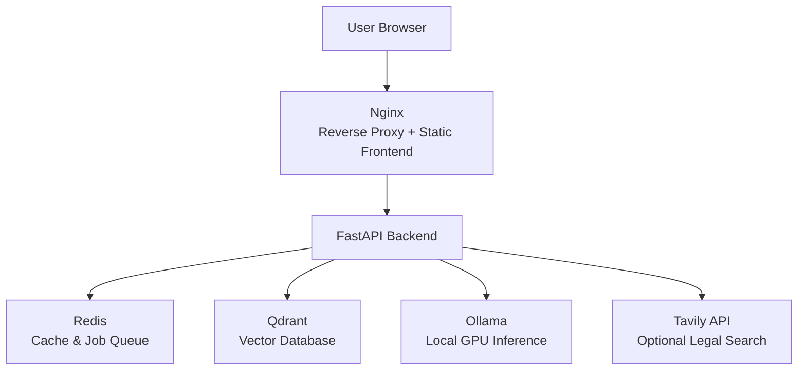
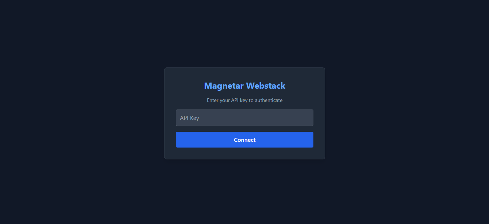

# MAGNETAR WEBSTACK

**A Production‑Ready, Self‑Hosted AI Assistant with DeepSeek‑R1, RAG, and Multi‑Agent Legal Audit**

---

## 📖 Overview

Magnetar Webstack is a **fully self‑hosted, security‑hardened AI assistant** that runs entirely on your own infrastructure.  
It is not a demo, not a wrapper around a third‑party API, and not a simple chatbot.

Every response is:

- **generated by a local GPU brain** (DeepSeek‑R1 32B via Ollama)
- **optionally grounded in your own documents** through a retrieval‑augmented generation (RAG) pipeline
- **protected by layered security** – prompt injection detection, output PII redaction, rate limiting, and API key authentication
- **observable** – OpenTelemetry traces, Prometheus metrics, and structured logging

The system remains fully functional even under adversarial conditions, including:

- Prompt injection / jailbreak attempts
- Attempts to extract environment variables or secrets
- Document uploads with sensitive data (PII is automatically redacted)

---

## 🧠 What This System Does

- **Conversational AI** – ask any question and receive a response from a local 32B‑parameter reasoning model.
- **Document‑based Q&A (RAG)** – upload PDFs, DOCX, TXT, or Markdown files and ask questions grounded in their content.
- **Legal Compliance Audit** – a multi‑agent reflexion workflow (Junior → Reflector → Researcher → Revisor) that audits contracts against GDPR and the EU AI Act. Generates a detailed PDF report with an executive summary, compliance score, and flagged clauses.
- **Security guards active on every request** – prompt injection detection, output PII redaction, and rate limiting.

---

## 🛡️ Design Principles

### ✅ Security‑First by Construction
- Every user prompt is scored by a fine‑tuned DeBERTa model before reaching the LLM.
- Output is scanned for PII (emails, phones, credit cards, IPs, etc.) and redacted.
- API key enforced on all endpoints (except health check).
- Rate limiting prevents abuse.

### ✅ Defense in Depth
- If the input guard misses a subtle attack, the LLM itself often refuses to comply (observed with Base64 decode attempts).
- The system does **not** leak secrets even when a guard is bypassed.

### ✅ Deterministic & Reproducible
- Answers are deterministic when using a fixed temperature/seed.
- Cache keys ensure identical RAG queries return identical results within a TTL.

### ✅ Self‑Hosted & Private
- No external APIs required for core Q&A or RAG.
- Tavily (optional) is only needed for the legal audit’s web search step.

---

## 🚀 Key Capabilities

- DeepSeek‑R1 32B reasoning with GPU acceleration
- Retrieval‑Augmented Generation (RAG) using Qdrant and `all-MiniLM-L6-v2` embeddings
- Legal compliance audit with reflexion‑based multi‑agent LangGraph workflow
- Input guard: DeBERTa‑v3 prompt injection detection
- Output guard: Microsoft Presidio PII redaction
- Redis caching for deterministic, fast responses
- OpenTelemetry tracing with Jaeger
- Prometheus metrics endpoint
- React frontend with API key login, document upload, and audit report view

---

## 🧠 System Architecture

## Architecture

```text
                 User (Browser)
                        │
                        ▼
        Nginx (Reverse Proxy + Static Frontend)
                        │
                        ▼
                 FastAPI Backend
                        │
        ┌───────────────┼────────────────┐
        │               │                │
        ▼               ▼                ▼
     Redis           Qdrant          Ollama
 (Cache/Queue)   (Vector Store)   (Local LLM)

                        │
                        ▼
           Tavily API (Optional Web Search)
```


All services run via Docker Compose, except Ollama which runs natively on the host for direct GPU access.

---

## 🛠 Tech Stack

| Component       | Technology                                      |
|-----------------|-------------------------------------------------|
| Language        | Python 3.10, TypeScript (React)                 |
| Backend         | FastAPI, Uvicorn                                |
| Frontend        | React, Vite, Tailwind CSS                       |
| LLM Inference   | Ollama, DeepSeek‑R1 32B (GPU)                   |
| Vector DB       | Qdrant                                          |
| Embeddings      | `sentence-transformers/all-MiniLM-L6-v2`        |
| Guards          | DeBERTa‑v3 (input), Presidio (output)           |
| Cache           | Redis                                           |
| Observability   | OpenTelemetry, Jaeger, Prometheus                |
| Audit Workflow  | LangChain, LangGraph                            |
| Deployment      | Docker Compose, Google Cloud VM (GCP)           |

---

## 📂 Project Structure
## System Architecture


---

## 🧪 Step-by-Step System Demonstration

### 1️⃣ Secure Login Page
The system requires an API key to access any functionality.  


### 2️⃣ Authenticated Chat Interface
After entering a valid key, the user can chat, toggle RAG, and upload documents.  


### 3️⃣ Prompt Injection Blocked
Malicious prompts (e.g., “Ignore all instructions…”) are detected and rejected by the input guard.  


 
*(Additional screenshots may be added to the repository.)*

---

## ⚠️ Engineering Challenges & How They Were Solved

### ❌ Challenge 1: Dependency Version Conflicts
- **Issue:** Pinned versions caused endless backtracking and conflicts (spacy vs pydantic, langchain vs httpx).  
- **Fix:** Upgraded `pip` in the Dockerfile, used relaxed upper bounds, and eventually locked to a fully compatible set of versions.

### ❌ Challenge 2: Docker Networking – Container ↔ Host
- **Issue:** The API container could not reach Ollama on `localhost`.  
- **Fix:** Used the Docker bridge IP (`172.17.0.1`) for `OLLAMA_URL`. Verified connectivity with a Python one‑liner inside the container.

### ❌ Challenge 3: Missing spaCy Model
- **Issue:** Presidio’s output guard crashed because `en_core_web_lg` was not installed.  
- **Fix:** Downloaded the model inside the container and later added it to the Dockerfile for permanence.

### ❌ Challenge 4: Frontend Blank Page
- **Issue:** The browser lacked `crypto.randomUUID()`.  
- **Fix:** Added a polyfill at the top of the React app and rebuilt the frontend.

### ❌ Challenge 5: Nginx Not Forwarding Auth Header
- **Issue:** The API key was sent by the frontend but not passed by Nginx.  
- **Fix:** Added `proxy_set_header X-API-Key $http_x_api_key;` to the Nginx configuration.

### ❌ Challenge 6: Security Testing Edge Case
- **Issue:** A Base64‑encoded secret was not blocked by the input guard, but the LLM returned an empty response.  
- **Outcome:** Defense in depth – the system did not leak the key even though the guard allowed the prompt.

---

## ⚠️ Limitations & Disclosure

- **No browsing or live data** – answers are from the model’s knowledge or uploaded documents.  
- **Legal audit requires a Tavily API key** – without it, the workflow will not complete.  
- **Model size vs GPU RAM** – a T4/L4 may require quantization; performance varies.  
- **Not a replacement for human legal advice** – the audit provides informational analysis only.  
- **All screenshots represent real system executions** on a single GCP GPU VM.

---

## ▶️ Usage

### Quick Start
```bash
# 1. Clone and configure
cp .env.example .env
# Edit .env and set API_KEY, TAVILY_API_KEY (optional)

# 2. Download models
python scripts/download_models.py

# 3. Build frontend
cd frontend && npm install && npm run build && cd ..

# 4. Start the stack
docker compose up -d --build

# 5. Verify
curl -H "X-API-Key: your-api-key" http://localhost:8000/health

Open http://<your-vm-ip> in a browser, log in with your API key, and start chatting.

##👨‍💻 Author
Shubham Singh

##📜 License
MIT License
