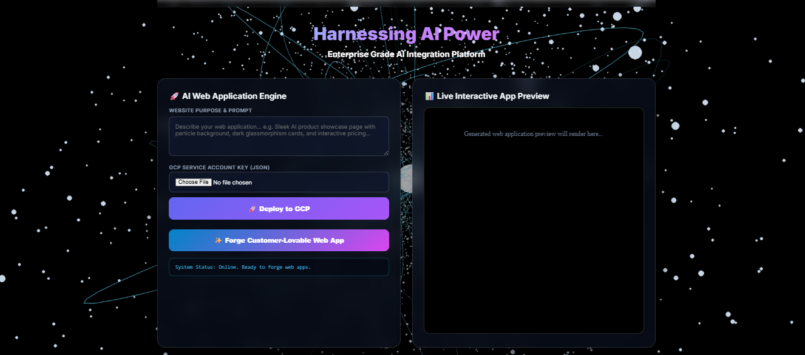
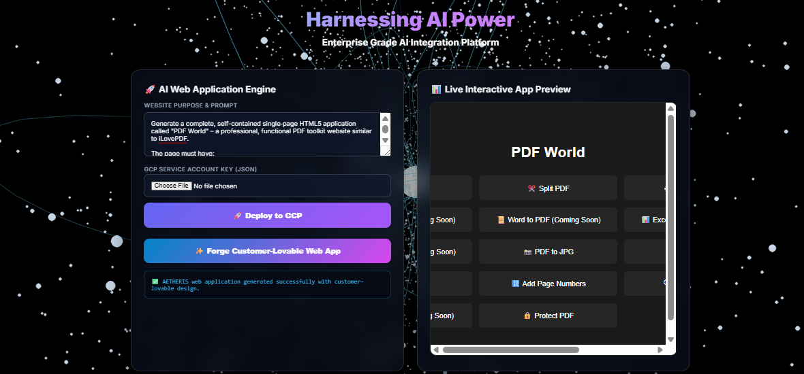
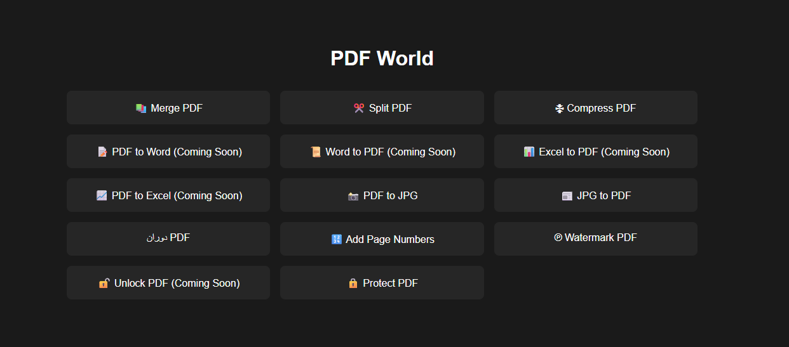

# ⚡ AETHERIS‑WEBFORGE

**AI‑Powered Web Application Generator, Hardened RAG, & One‑Click GCP Deployment Engine**

---

## 📖 Overview

AETHERIS‑WEBFORGE is a production‑ready platform that turns natural language prompts into **complete, self‑contained HTML5 web applications**.  
It uses a **local GPU‑accelerated AI brain** (Qwen2.5‑Coder 32B via Ollama) to generate professional, functional websites entirely on‑premise.

Every generated application is:
- **Client‑side ready** – single HTML file with all CSS/JS embedded.
- **Deployable in one click** – directly to Google Cloud Storage with a public URL.
- **Security‑hardened** – prompt injection guard, output sanitisation, and rate limiting.
- **Royalty‑free** – no branding, logos, or proprietary assets added.

The system demonstrates a full AI‑to‑production pipeline:  
`Prompt → AI Generation → Live Website`

---

## 🚀 Features

- **🧠 Local AI Brain** – Qwen2.5‑Coder 32B (or any Ollama model) running on GPU.
- **🛡️ Security Guardrails** – Prompt injection detection and output filtering.
- **📦 One‑Click GCP Deploy** – Uploads generated HTML to a Cloud Storage bucket (no API keys required).
- **⚡ Zero‑Setup Deployment** – The VM’s built‑in identity handles authentication automatically.
- **🎨 Clean, Modern UI** – Responsive dashboard with live preview iframe.
- **📂 Support for External Libraries** – The AI can use CDN‑based frameworks (Tailwind, Bootstrap, PDF‑lib, jsPDF, etc.) when appropriate.

---

## 🧠 Technology Stack

| Component         | Technology                                      |
|-------------------|-------------------------------------------------|
| Language          | Python 3.10                                     |
| Backend           | FastAPI, Uvicorn                                |
| Frontend          | Vanilla HTML/CSS/JS (served directly)           |
| AI Inference      | Ollama, Qwen2.5‑Coder 32B (GPU)                 |
| Security          | Custom prompt injection guard (regex + heuristics) |
| Deployment        | Google Cloud Storage (Python client)            |
| Infrastructure    | Docker, Google Cloud GPU VM (L4)                |

---

## 📸 Live Demonstration – PDF World

*The following screenshots show a complete end‑to‑end workflow using AETHERIS‑WEBFORGE to generate a **PDF toolkit website** similar to iLovePDF.*

### 1. Main Interface & Prompt
The user enters a detailed prompt describing the desired application.


### 2. AI‑Generated Web Application
The Qwen2.5‑Coder model generates a fully functional HTML file with PDF manipulation tools (merge, split, compress, convert, etc.).


### 3. One‑Click GCP Deployment
With a single click, the generated website is uploaded to Google Cloud Storage and a public URL is returned.



---

## ⚡ Quick Start (Deploy on a GPU VM)

1. **Clone the repository**
   ```bash
   git clone https://github.com/shubham-61291/aetheris-webforge.git
   cd aetheris-webforge
